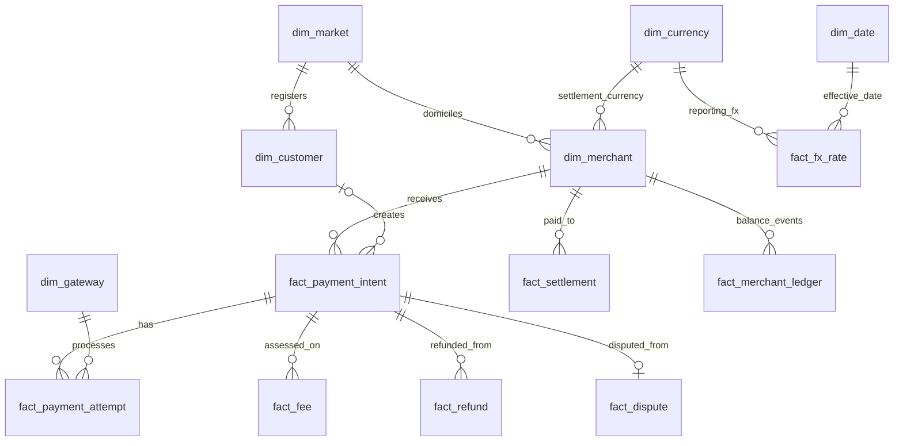

# FinPay Global — Phase 1 Data Contract (v2.0)

**Status:** Implementation-ready synthetic portfolio design; generated CSV facts require an additional real-FX import for complete USD reporting.  
**Document owner:** Data & BI Engineering. **Snapshot cutoff:** `2026-10-01T00:00:00Z` (exclusive).  
**Period:** `2021-10-01` through `2026-09-30`, inclusive; **60 calendar months**.  
**All people, merchants, transactions, approvals, fees, disputes, payouts and outages are fictional.** FX must be real historical reference data and may not be invented.

## 1. Business scope

FinPay Global is a fictional international PSP servicing 2,000 merchants and 100,000 registered customers (and guests) with hosted checkout, gateway routing, multi-attempt payment flows, fee billing, processor costs, post-payment servicing, merchant payouts and a merchant-payable subledger. Leadership seeks to optimize payment acceptance, processor performance, merchant growth, contribution margins, risk losses, and reconciliation controls. See [business_scenario.md](business_scenario.md) and [core_business_questions.md](core_business_questions.md).

## 2. Fixed dataset contract

| Property | v2 contract |
|---|---|
| Coverage | 60 months, 2021-10 through 2026-09 |
| Registered customers | **100,000** |
| Merchants | **2,000** |
| Checkout / payment intents | **1,620,000** (about 810 intents per merchant over 5 years) |
| Payment attempts | **Approximately 1.7–1.9 million**, contingent on genuine retries; never force one per intent |
| Fee events | About 2.8–3.0 million; 2 for every successful capture plus lost-dispute fees |
| Merchant balance events | About 3 million; captured credits, merchant fees, successful refunds, lost dispute principal and fees, paid settlements |
| Other facts | Refunds, disputes, settlement instructions and daily FX (real reference rates, pending download) |
| Total records | **Target 8–10 million** across facts and dimensions; exact totals in `data/manifest.json` |
| Merchant countries | US, GB, DE, FR, CA, AU, JP, CN, IR, RU, MX, EG |
| Transaction currencies | **10**: USD, EUR, GBP, CAD, AUD, JPY, CNY, RUB, MXN, EGP |
| Payment methods | `card`, `wallet`, `bank_debit` |
| Gateways | 5: AtlasFlow, BlueHarbor, OrbitRoute, NovaSwitch, PineBridge (all fictional) |
| Canonical storage | UTC timestamps, money in integer local minor units, dates in ISO format |
| Reporting currency | **USD from actual historical daily reference FX only** |
| Reproducibility | NumPy seeded with `20261021`, deterministic synthetic generator |

### Currency count versus market count: explicit resolution

All 12 merchant markets imply **11 distinct domestic currencies** because DE/FR share EUR: USD, GBP, EUR, CAD, AUD, JPY, CNY, **IRR**, RUB, MXN, EGP. The user-specified limit is 10. This model excludes IRR; the **Iran market is USD-only and sandbox/fictional**. These records are not claims of service availability or compliant payment corridors. Russia is another fictional market scenario not a claim about global-network access. No buyer identifiers, bank details or actual transactions are used. An 11-currency IRR design is a future extension requiring vetted price and FX sources and appropriate legal interpretation.

### Cross-border and FX simplification

Payments are **presented and settled in each merchant's designated currency**. `fact_payment_intent.amount_minor` and `captured_settlement_minor` are equal when captured. There is no real-time merchant FX conversion, FX spread, currency-conversion fee or cross-border settlement modeled in v2. This avoids leaking fictitious exchange rates into the merchant ledger. The only FX operation is **historical USD normalization for business reporting** using `fact_fx_rate`. If real rates cannot be obtained, those USD KPIs remain unavailable, and all local-currency facts remain valid.

## 3. Table conventions and relationships

Naming rule: **`dim_`** for relatively stable descriptive dimensions, **`fact_`** for event observations / financial measures. Every fact has an explicit primary grain. Persist operational foreign keys and build analytical views with fact→dimension many-to-one relationships.

**Primary fact grain and keys:**

| Table | Grain | Primary key | Main dimensional FKs | Parent/event relationship |
|---|---|---|---|---|
| `fact_payment_intent` | 1 checkout | `intent_id` | `merchant_id`, optional `customer_id`, `buyer_country` | Parent payment entity |
| `fact_payment_attempt` | 1 gateway request | `attempt_id` | `gateway_id` | `intent_id` → `fact_payment_intent` |
| `fact_fee` | 1 fee assessment / processor cost | `fee_id` | Merchant derived through intent | `intent_id`; optional `dispute_id` |
| `fact_refund` | 1 refund request | `refund_id` | Merchant derived through intent | `intent_id` |
| `fact_dispute` | 1 dispute case | `dispute_id` | Merchant derived through intent | `intent_id`, unique |
| `fact_settlement` | 1 payout instruction | `settlement_id` | `merchant_id`, `currency_code` | Merchant payable settlement |
| `fact_merchant_ledger` | 1 signed balance posting | `entry_id` | `merchant_id`, `currency_code` | `event_type` + `source_id` (polymorphic audit ref) |
| `fact_fx_rate` | 1 currency per UTC calendar date | (`rate_date`,`currency_code`) | `dim_currency`, `dim_date` | Real USD conversion lookup |

**Dimensions:** `dim_merchant`, `dim_customer`, `dim_gateway`, `dim_currency`, `dim_market`, `dim_date`. The field-level names, PostgreSQL types, nullability and tests are in [data_dictionary.md](data_dictionary.md). All facts must avoid ambiguous join paths and fanout. The `fact_merchant_ledger.source_id` is a polymorphic event key; it is validated by `event_type`, and cannot be represented as a single ordinary PostgreSQL foreign key.

## 4. Payment lifecycle and referential constraints

1. A unique checkout intent (`fact_payment_intent`) belongs to exactly one merchant and may be linked to a registered customer or to a guest (`NULL`).
2. An intent has zero attempts (abandoned checkout) or up to three **ordered** attempts. A retry exists only after the previous failed attempt.
3. Succeeded intents have **exactly one** successful attempt and captured principal. No later attempts occur after success.
4. Failed intents have no successful attempt. Pending intents have an unresolved attempt; no merchant balance posting is created. Abandoned intents have zero attempts.
5. Each capture generates exactly one merchant processing-fee fact and one processor-cost fact. Processor cost is not a merchant payable debit.
6. Successful refunds can occur only after capture; no more than captured principal is refunded. Pending and failed refunds have no ledger debit.
7. One dispute at most per captured card payment; successful refunds and disputes are mutually exclusive **in this simplified simulation**. Lost disputes create principal and separately assessed merchant dispute-fee debits; open and won disputes don't.
8. Payouts are instructions. Only `status='completed'` changes merchant payable; pending/failed instructions never do.
9. All postings are in local **settlement-currency minor units**. There are **no fake exchange rate transactions**.
10. Time series: capture after successful attempt start; refund/dispute after capture; dispute resolution after open; payout after initiation; no recorded event at/after cutoff.

## 5. Reconciliation and financial controls

For each merchant `m`, settlement currency `c` and reporting cutoff `t`:

$$
\begin{split}
\mathrm{ClosingPayable}_{m,c,t} = {} & \mathrm{CapturedGross}_{m,c,t} \\
 &-\mathrm{MerchantFees}_{m,c,t} \\
 &-\mathrm{SuccessfulRefunds}_{m,c,t} \\
 &-\mathrm{LostDisputePrincipal}_{m,c,t} \\
 &-\mathrm{DisputeFees}_{m,c,t} \\
 &-\mathrm{CompletedPayouts}_{m,c,t}.
\end{split}
$$

The same value must equal `SUM(fact_merchant_ledger.signed_amount_minor)` for the merchant and currency. **Zero difference (exact integer equality) is a release gate.** Negative payable can arise after post-payout disputes and should be surfaced as a receivable. Processor costs are platform expenses in `fact_fee`, never booked as merchant payable reductions.

Financial entries expected per event:

| Trigger | Ledger event | Signed amount |
|---|---|---|
| Successful capture | `capture_credit` | +captured settlement principal |
| Assessment of merchant fee | `merchant_fee_debit` | −merchant fee |
| Successful refund | `refund_debit` | −actual local refund principal |
| Lost dispute resolution | `dispute_debit` | −lost principal |
| Lost dispute fee assessment | `dispute_fee_debit` | −assessed dispute fee |
| Completed payout | `payout_debit` | −payout amount |
| Processor cost | **No merchant ledger event** | Platform expense only |

**Illustration:** USD capture 100.00; merchant fee 3.00; processor cost 1.80; completed payout 97.00 → merchant closing payable 0.00; PSP processing contribution 1.20 before overhead. Currency conversion occurs only in USD reporting, not in ledger calculations.

## 6. KPI contract

The canonical definitions are in [kpi_definitions.md](kpi_definitions.md). Required headline metrics are intent conversion, attempt success, captured TPV USD (FX-gated), average ticket, fee revenue, processing contribution, fee take rate, active/retained merchants, value-weighted method mix, gateway failure/latency, mature refund and dispute cohorts, payout SLAs and per-merchant-currency reconciliation.

## 7. Benchmark provenance and analytics patterns

**Measured observations and synthetic assumptions are distinct.** The model uses published payment and pricing references to inform direction/scale while keeping records fictitious. See [benchmark_assumptions.md](benchmark_assumptions.md).

- **Published:** Worldpay reports wallets at 49% of e-commerce *value* in 2022, 53% in 2024 and 56% in 2025 (source definitions differ). No single source proves our fictional firm's wallet transaction-count share.
- **Published:** Stripe US standard card pricing shows 2.9% + $0.30 for domestic successful card payments, with additional charges for some international transactions.
- **Synthetic:** Intent traffic increases over 5 years, peaks in Nov/Dec, and varies by merchant/industry. Merchant propensity is heavy-tailed.
- **Synthetic:** Authorization depends on country, method, gateway and incidents, and retries can rescue failed first attempts.
- **Synthetic:** Higher refund propensities in travel/retail, lower in food/services; rare card dispute cases with delayed resolution.
- **Synthetic:** Distinct merchant pricing tiers and varying processor costs produce marginally profitable/unprofitable payment segments.
- **Synthetic:** Explicit gateway-3 incident dates 2023-06-13/14, 2025-02-11/12, 2026-04-17 generate investigation-worthy outage patterns.

**These patterns are for analysis training, not evidence of real-world market performance.** Publication figures are not applied as exact success/refund/fraud probability constraints.

## 8. Historical FX requirement and blocker

`fact_fx_rate` must contain USD per one local **major** unit at every UTC date/currency, derived from actual dated observations (forward-fill **only** to weekends/holidays, preserve `observation_date`). Download with `python src/fetch_fx.py --data-dir data` using Frankfurter v2 central-bank blend; fail loudly if source history is missing or a long gap remains. Current export initially contains **only USD=1 identity** and `manifest.json` clearly marks FX as **INCOMPLETE**. Do **not** publish global USD TPV/revenue until all 10-currency real FX rows exist, provenance is verified and model reports pass. Source: https://frankfurter.dev/; ECB historical RUB publication was suspended after 2022-03-01, so a pure ECB feed cannot satisfy RUB coverage: https://www.ecb.europa.eu/stats/policy_and_exchange_rates/euro_reference_exchange_rates/html/index.en.html. Provider-specific official source definitions/market accessibility require review; real reference rates are not executable prices.

## 9. Acceptance tests and limitations

| Test | Acceptance |
|---|---|
| Primary/foreign key | No duplicates or orphans, nullable customer only for guests |
| Transaction lifecycle | Exactly one successful attempt per succeeded intent, no impossible retries |
| Temporal integrity | Correct event order and snapshot cutoff |
| Financial | Exactly zero unexplained merchant-currency residual in minor units |
| Aggregate source vs ledger | Every capture/merchant fee/successful refund/lost dispute/completed payout has 1 matching posting |
| FX provenance | Every non-USD calendar date covered by real source observation or tagged prior-day carry, never synthetic |
| Volume | 8–10m rows total; 100k customers; 2k merchants; 1.62m intents |
| Reproducibility | Same generator seed yields deterministic files and counts |
| Realism | Independent reports on seasonal traffic, merchant concentration, method-mix trend, gateway incident days |

**Limitations:** fee economics are approximations; the generator's monthly payout batching does not implement the stored weekly payout preference; it is not a real-time settlement engine; no true FX settlement trades; IRR excluded; Iran USD-only and Russia synthetic market assumptions must not be represented as available legal PSP corridors. Snapshot is censored for recent post-payment outcomes. **Risk rates are entirely synthetic even when motivated by external benchmarks.**

## 10. Deliverables and execution

- `src/generate.py`: deterministic complete synthetic facts, dimensions, local-currency ledger.
- `src/fetch_fx.py`: **separate internet-required** importer for real FX, fails closed.
- `data/*.csv.gz`: generated outputs, `data/manifest.json` records counts/FX status.
- `sql/schema.sql`: PostgreSQL DDL, PK/FKs and indexes.
- `tests/validate.py`: sample/full reconciliations and data invariants.
- `docs/*.md`: scenario, questions, KPI contract, dictionary, evidence and caveats.

Install dependencies via `requirements.txt`. Run `python src/generate.py --intents 1620000 --out data`, then fetch verified real historical FX when connectivity permits, then load CSV files into PostgreSQL and build star-schema reporting views for Power BI.
