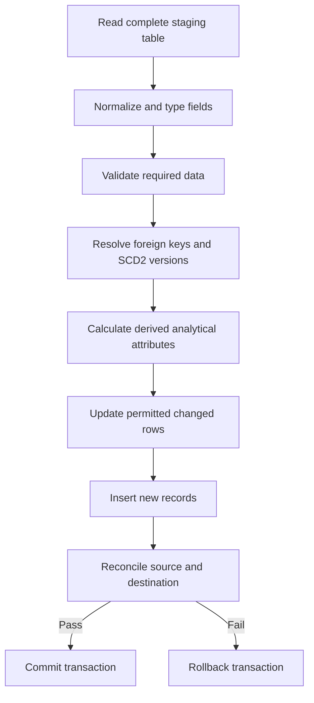

# FinPay Global — SQL Server Staging-to-Warehouse ETL Documentation

**Documentation date:** 2026-11-03

## Table of contents

- [1. Executive overview](#1-executive-overview)
- [2. Dataset and architecture contract](#2-dataset-and-architecture-contract)
- [3. Phase A — Prepare the files](#3-phase-a--prepare-the-files)
- [4. Phase B — Import CSV files as SQL Server staging tables](#4-phase-b--import-csv-files-as-sql-server-staging-tables)
- [5. Phase C — Create the `main` analytical tables](#5-phase-c--create-the-main-analytical-tables)
- [6. Phase D — Run the stored-procedure ETL](#6-phase-d--run-the-stored-procedure-etl)
- [7. Phase E — Quality assurance and reconciliation](#7-phase-e--quality-assurance-and-reconciliation)
- [8. Known implementation caveats and pre-deployment review](#8-known-implementation-caveats-and-pre-deployment-review)

---

## 1. Executive overview

FinPay uses a **two-layer SQL Server warehouse**: a staging layer that reproduces the prepared source datasets, and a dimensional reporting layer populated by SQL Server ETL procedures.

1. Generate and clean the source datasets upstream using Python.
2. Save one **processed CSV file** for each dimension or fact.
3. Import every processed CSV file into the matching `stg.<table_name>` table using SQL Server Management Studio (SSMS).
4. Check import counts and schema conformity before processing.
5. Build `main` dimension and fact tables using table-specific DDL.
6. Execute `dbo.usp_Load...` procedures in dependency order.
7. Validate keys, row counts, history, financial postings and USD reporting.
8. Connect Power BI to the curated `main` layer, not the staging tables.

The data pipeline follows this architecture:


**The two-schema architecture** separates data ingestion from analytical modeling:

- **`stg` schema:** Serves as the landing layer containing prepared source datasets.
- **`main` schema:** Contains the validated analytical dimensions and facts, including relationships, historical dimension versions, and derived attributes.

This separation isolates reporting logic from source-file imports and provides a repeatable input contract for ETL.

---

## 2. Dataset and architecture contract

| Attribute | FinPay contract |
|---|---|
| Time range | 2021-10-01 through 2026-09-30 (60 months) |
| Exclusive reporting cutoff | 2026-10-01 00:00:00 UTC |
| Customers | 100,000 registered, plus guest transactions |
| Merchants | 2,000 |
| Markets | US, GB, DE, FR, CA, AU, JP, CN, IR, RU, MX, EG |
| Reporting currency | USD |
| Transaction currencies | USD, EUR, GBP, CAD, AUD, JPY, CNY, RUB, MXN, EGP |
| Payment intents | 1,620,000 in the fixed dataset contract |
| Payment attempts | Approximately 1.7–1.9 million |
| Overall volume | Approximately 8–10 million rows across tables |
| Currency policy | Merchant payments and settlement in the same local settlement currency; FX used for historical USD analytics |
| Data status | Payments, merchants and customers are fictional/synthetic; FX observations are sourced from real historical reference data |

**Database schemas**

| Schema | Responsibility |
|---|---|
| `stg` | Imported processed CSV data without analytical SCD history |
| `main` | Analytical dimensions and fact tables with keys, constraints and ETL-managed history |
| `dbo` | SQL Server stored procedures implementing the ETL pipeline |

### 2.1 Tables in scope

The project defines **14 tables: 6 dimensions and 8 facts**.

| Processed CSV file | Staging table | Warehouse table | Model / grain |
|---|---|---|---|
| `dim_currency.csv` | `stg.dim_currency` | `main.dim_currency` | Currency reference; SCD1 |
| `dim_market.csv` | `stg.dim_market` | `main.dim_market` | Market reference; SCD1 |
| `dim_date.csv` | `stg.dim_date` | `main.dim_date` | One day; static calendar |
| `dim_gateway.csv` | `stg.dim_gateway` | `main.dim_gateway` | Gateway business key + SCD2 version |
| `dim_merchant.csv` | `stg.dim_merchant` | `main.dim_merchant` | Merchant business key + SCD2 version |
| `dim_customer.csv` | `stg.dim_customer` | `main.dim_customer` | Customer business key + SCD2 version |
| `fact_payment_intent.csv` | `stg.fact_payment_intent` | `main.fact_payment_intent` | One checkout intent; accumulating snapshot |
| `fact_payment_attempt.csv` | `stg.fact_payment_attempt` | `main.fact_payment_attempt` | One gateway request |
| `fact_fee.csv` | `stg.fact_fee` | `main.fact_fee` | One fee / processor cost assessment |
| `fact_refund.csv` | `stg.fact_refund` | `main.fact_refund` | One refund request |
| `fact_dispute.csv` | `stg.fact_dispute` | `main.fact_dispute` | One dispute case |
| `fact_settlement.csv` | `stg.fact_settlement` | `main.fact_settlement` | One merchant payout instruction |
| `fact_merchant_ledger.csv` | `stg.fact_merchant_ledger` | `main.fact_merchant_ledger` | One signed balance posting |
| `fact_fx_rate.csv` | `stg.fact_fx_rate` | `main.fact_fx_rate` | One UTC date × currency |

All 14 prepared datasets are exported as CSV files in `data/processed/`, with matching table names in `stg` and `main`.

The warehouse additionally derives `main.fact_payment_intent.transaction_market_type` during its load. This derived field is not required in `stg.fact_payment_intent`.

---

## 3. Phase A — Prepare the files

### 3.1 Upstream cleaning and transformation

Preprocessing is a separate stage from SQL Server loading. The Python/Polars preprocessing stage includes:

- Casting identifiers, categorical values and UTC timestamps.
- Calculating major-unit amounts using `dim_currency.minor_units`.
- Deriving payment resolution, refund, dispute and payout durations.
- Joining historical FX rates to calculate USD reporting amounts.
- Producing one prepared dimension or fact dataset for warehouse ingestion.

The prepared tables are written as **CSV files to `data/processed/`** by the updated `save_data` function.

SQL Server receives these processed datasets rather than the raw inputs. The subsequent warehouse ETL resolves analytical keys, handles history and lifecycle changes, derives additional analytical attributes, and enforces relationship integrity.

---

## 4. Phase B — Import CSV files as SQL Server staging tables

### 4.1 Staging schema and import interface

The processed CSV files are imported through **SQL Server Management Studio (SSMS)** using the **Import Flat File** wizard.

The destination schema is `stg`, and each CSV file is loaded into a staging table with the same dataset name.

The wizard creates the staging table as part of the import operation. Staging-table DDL and `BULK INSERT` are not used in this workflow.

The `stg` schema exists in the target database before importing the CSV files.

Within SSMS, the schema is accessible through:

`Databases → [database] → Security → Schemas`

After import, the staging tables are accessible through:

`Databases → [database] → Tables`

### 4.2 Import Flat File process

The following import process is applied to each of the 14 processed CSV files:

1. Connect to SQL Server using SSMS and select the target database.
2. Right-click the database and select **Tasks → Import Flat File**.
3. Select the corresponding CSV file from `data/processed/`.
4. Configure the destination schema as `stg` and assign the corresponding table name.
5. Review the **Preview Data** page to confirm the imported column names and row structure.
6. Review the **Modify Columns** page to confirm inferred SQL Server data types, string lengths, decimal precision, datetime types and nullability.
7. Complete the import and inspect the result.

For example:

| Source file | Imported staging table |
|---|---|
| `data/processed/dim_merchant.csv` | `stg.dim_merchant` |
| `data/processed/fact_payment_intent.csv` | `stg.fact_payment_intent` |
| `data/processed/fact_fee.csv` | `stg.fact_fee` |
| `data/processed/fact_fx_rate.csv` | `stg.fact_fx_rate` |

The Import Flat File wizard creates a new table and does not function as an in-place refresh of an existing staging table.

The subsequent ETL procedures consume the resulting complete staging snapshots.

### 4.3 Staging layer characteristics

| Property | Description |
|---|---|
| Input format | CSV |
| Input directory | `data/processed/` |
| Import interface | SQL Server Management Studio — Import Flat File |
| Destination schema | `stg` |
| Table naming | Matches processed CSV dataset names |
| Data types | Inferred or configured through the SSMS import interface |
| Data grain | Preserved from the processed datasets |
| SCD history | Not generated in staging |
| ETL source model | Full staging snapshots |
| Analytical transformations | Performed by stored procedures during loading into `main` |

The staging tables preserve the processed source data without generating analytical surrogate keys or historical dimension versions.

Because SQL Server's import wizard infers data types from sampled records, staging data types may differ from the analytical target table types.

The stored procedures normalize and validate the staging data before inserting or updating warehouse records.

**UI reference:** [Microsoft Learn — Import Flat File to SQL Wizard](https://learn.microsoft.com/en-us/sql/relational-databases/import-export/import-flat-file-wizard)

---

## 5. Phase C — Create the `main` analytical tables

### 5.1 Dimensional modeling decisions

The warehouse is organized into dimension and fact tables.

Dimensions are created and populated before their dependent fact tables so that fact records can resolve analytical foreign keys.

| Dimension | Load policy | Key policy |
|---|---|---|
| `dim_currency` | Type 1 / stable reference | `currency_code` unique business/PK key |
| `dim_market` | Type 1 / stable reference | `country_code` unique business/PK key |
| `dim_date` | Static date reference | `date_key` YYYYMMDD |
| `dim_gateway` | SCD Type 2 | `gateway_id` business key; `gateway_sk` identity surrogate |
| `dim_merchant` | SCD Type 2 | `merchant_id` business key; `merchant_sk` identity surrogate |
| `dim_customer` | SCD Type 2 | `customer_id` business key; `customer_sk` identity surrogate |

SCD Type 2 records contain:

- `valid_from`
- `valid_to`
- `is_current`
- `version_number`

Each business key has at most one active version.

When a tracked attribute changes, its ETL procedure closes the current version and inserts a new historical version without deleting previous records.

Repeated loads of unchanged snapshots do not create additional historical versions.

**Historical dimension interpretation:** SCD Type 2 history begins with the first ETL observation. Loading the warehouse in 2026 does not reconstruct the actual historical attributes of merchants or customers from 2021.

The earlier FinPay fact loaders use version 1 as the documented baseline for fact timestamps preceding recorded SCD history. This is a modeling approximation rather than verified historical state.

### 5.2 Fact policies

| Fact table | Grain | Mutation behavior |
|---|---|---|
| `fact_payment_intent` | One checkout | Accumulating snapshot; pending may resolve; original identifiers and principal are protected |
| `fact_payment_attempt` | One gateway request | Attempt identity remains stable; pending may resolve |
| `fact_fee` | One fee assessment | Local-currency financial values are immutable; reporting USD may backfill |
| `fact_refund` | One refund request | Pending may resolve; original request principal is protected |
| `fact_dispute` | One dispute case | Open may become won/lost; final financial state is protected |
| `fact_settlement` | One payout instruction | Pending may become completed/failed; original payout amount is protected |
| `fact_merchant_ledger` | One signed posting | Local financial posting amount is immutable |
| `fact_fx_rate` | One date/currency | Accepted historical rates are protected; missing observations may be backfilled |

Fact tables do not use SCD Type 2.

Each fact represents either a business event or a business entity's lifecycle at a defined analytical grain.

Fact-table changes are managed through insertion, permitted lifecycle updates, or the financial correction mechanism associated with the originating event.

### 5.3 Payment transaction market classification

The `main.fact_payment_intent` table includes the derived analytical attribute:

`transaction_market_type VARCHAR(15)`

This attribute classifies a payment as either a domestic transaction or a cross-border transaction.

It is calculated during execution of:

`dbo.usp_LoadFactPaymentIntent`

The classification compares:

- `buyer_country`: The customer's country recorded in the payment intent.
- `country_code`: The merchant's country stored in `main.dim_merchant`.

**Classification formula**

```sql
CASE
    WHEN pi.buyer_country = m.country_code
    THEN 'Domestic'
    ELSE 'Cross-border'
END AS transaction_market_type
```

In this logical expression:

- `pi` represents the payment-intent source.
- `m` represents the associated merchant record.

The ETL implementation resolves the relevant merchant version through the existing `merchant_id` relationship and the payment intent's `created_at` timestamp.

The resulting classifications are:

| Condition | `transaction_market_type` |
|---|---|
| Buyer country equals merchant country | `Domestic` |
| Buyer country differs from merchant country | `Cross-border` |
| Buyer country is `NULL` | `Cross-border` |

The final case follows the exact SQL `CASE` expression: a `NULL` comparison does not satisfy the `WHEN` condition and therefore takes the `ELSE` branch.

**ETL integration**

The derived attribute is:

1. Calculated when resolving the source payment intent against `main.dim_merchant`.
2. Included in the resolved payment-intent dataset.
3. Written into `main.fact_payment_intent` during insertion.
4. Updated when a source record changes.
5. Included in the stored procedure's source-to-target reconciliation.

The attribute exists in the analytical warehouse table and is not required in the processed CSV or staging table.

### 5.4 Technical transformations performed by ETL

The SQL Server ETL procedures perform the following transformations:

- Resolve analytical surrogate keys such as `merchant_sk`, `customer_sk` and `gateway_sk`.
- Match event timestamps to the appropriate SCD Type 2 dimension versions.
- Derive calendar keys from timestamps.
- Normalize supported categorical values and optional fields.
- Enforce parent-child relationships across analytical tables.
- Classify payment intents as `Domestic` or `Cross-border`.
- Calculate or preserve currency-specific minor-unit amounts when supported.
- Preserve nullable reporting USD values when valid historical FX observations are unavailable.
- Apply controlled insert and update behavior according to each table's mutation policy.

Calendar keys are derived using:

```sql
YEAR(event_timestamp) * 10000
    + MONTH(event_timestamp) * 100
    + DAY(event_timestamp)
```

For example, a transaction occurring on November 3, 2026, would produce `20261103`. Within FinPay's defined reporting period, all generated date keys belong to October 2021 through September 2026.

The target `main` tables store the resulting analytical attributes, surrogate keys, business keys, and financial measures.

---

## 6. Phase D — Run the stored-procedure ETL

### 6.1 SQL script organization

Each analytical table is implemented through two SQL scripts.

**DDL script**

Defines the table in `main`, including:

- Column names and SQL Server data types.
- Primary keys and unique constraints.
- Foreign keys.
- Check constraints.
- Targeted indexes.

**ETL script**

Defines the table's stored procedure using:

`CREATE OR ALTER PROCEDURE dbo.usp_Load...`

It contains the staging-to-target loading logic, business transformations, validation, and transaction handling.

The ETL script ends with a `GO` batch separator and the corresponding `EXEC` statement.

For example:

```sql
CREATE OR ALTER PROCEDURE dbo.usp_LoadFactPaymentIntent
AS
BEGIN
    -- ETL logic
END;
GO

EXEC dbo.usp_LoadFactPaymentIntent;
```

The `GO` keyword is a client-side batch separator interpreted by tools such as SSMS and sqlcmd. It is not a T-SQL statement executed inside a stored procedure.

### 6.2 Dependency-aware execution order

The warehouse procedures are executed according to their dimension and fact dependencies.

The currency and date dimensions are available before loading the historical FX reference fact.

The transaction facts are then loaded in dependency order.

| Step | Stored procedure | Main dependencies |
|---:|---|---|
| 1 | `dbo.usp_LoadDimCurrency` | `stg.dim_currency` |
| 2 | `dbo.usp_LoadDimMarket` | `main.dim_currency` |
| 3 | `dbo.usp_LoadDimDate` | Calendar source or date-generation logic |
| 4 | `dbo.usp_LoadDimGateway` | `stg.dim_gateway` |
| 5 | `dbo.usp_LoadDimMerchant` | `main.dim_market`, `main.dim_currency` |
| 6 | `dbo.usp_LoadDimCustomer` | `main.dim_market` |
| 7 | `dbo.usp_LoadFactFxRate` | Currency and date dimensions |
| 8 | `dbo.usp_LoadFactPaymentIntent` | Merchant, customer, date, currency and market dimensions |
| 9 | `dbo.usp_LoadFactPaymentAttempt` | Payment intents, gateway and date dimensions |
| 10 | `dbo.usp_LoadFactFee` | Payment intents, date and currency dimensions |
| 11 | `dbo.usp_LoadFactRefund` | Payment intents, date and currency dimensions |
| 12 | `dbo.usp_LoadFactDispute` | Payment intents, attempts, refunds and dimensions |
| 13 | `dbo.usp_LoadFactSettlement` | Merchant, date and currency dimensions |
| 14 | `dbo.usp_LoadFactMerchantLedger` | Payment intents, fees, refunds, disputes, settlements and dimensions |

**Stored-procedure execution sequence**

```sql
-- Dimension tables
EXEC dbo.usp_LoadDimCurrency;
EXEC dbo.usp_LoadDimMarket;
EXEC dbo.usp_LoadDimDate;
EXEC dbo.usp_LoadDimGateway;
EXEC dbo.usp_LoadDimMerchant;
EXEC dbo.usp_LoadDimCustomer;

-- Historical FX reference
EXEC dbo.usp_LoadFactFxRate;

-- Transactional fact tables
EXEC dbo.usp_LoadFactPaymentIntent;
EXEC dbo.usp_LoadFactPaymentAttempt;
EXEC dbo.usp_LoadFactFee;
EXEC dbo.usp_LoadFactRefund;
EXEC dbo.usp_LoadFactDispute;
EXEC dbo.usp_LoadFactSettlement;

-- Financial ledger
EXEC dbo.usp_LoadFactMerchantLedger;
```

The payment-intent ETL derives `transaction_market_type` by joining the prepared intent records to the appropriate merchant dimension version.

The field is populated during inserts, handled during updates, and included in existing reconciliation logic.

**Deferred foreign-key relationship**

The optional `fact_fee.dispute_id` relationship references `main.fact_dispute.dispute_id`.

Because the fee fact is loaded before the dispute fact, the foreign-key constraint is installed after the dispute table exists.

Each stored procedure has its own transaction.

The execution sequence is not globally atomic: a failure in a later procedure does not reverse successfully committed loads from earlier procedures.

### 6.3 What happens inside a loader

Each stored procedure follows a controlled staging-to-warehouse transformation workflow.



The primary T-SQL mechanisms include:

```sql
SET NOCOUNT ON;
SET XACT_ABORT ON;

BEGIN TRY
    BEGIN TRANSACTION;

    -- Load the staging snapshot.
    -- Validate source records.
    -- Resolve analytical relationships.
    -- Apply permitted updates.
    -- Insert new records.
    -- Reconcile source and target.

    COMMIT TRANSACTION;
END TRY
BEGIN CATCH
    IF XACT_STATE() <> 0
        ROLLBACK TRANSACTION;

    THROW;
END CATCH;
```

Several designed procedures begin the transaction before capturing the staging snapshot.

This allows validation and loading to operate within a controlled transaction scope.

The implementation also uses `sys.sp_getapplock` where serialized execution is required to prevent concurrent loads of the same analytical table.

References:

- [Microsoft Learn — SET XACT_ABORT](https://learn.microsoft.com/en-us/sql/t-sql/statements/set-xact-abort-transact-sql)
- [Microsoft Learn — sp_getapplock](https://learn.microsoft.com/en-us/sql/relational-databases/system-stored-procedures/sp-getapplock-transact-sql)

### 6.4 Snapshot versus incremental updates

The current FinPay ETL procedures are based on **full-snapshot loading**.

Under this model:

- Each staging table contains the complete historical dataset within its defined scope.
- Every existing destination business key is expected to remain present in staging.
- Newly introduced records are inserted.
- Changed records are updated only when their table's mutation policy allows it.
- Unchanged records remain unchanged.
- Historical financial events are protected from unauthorized modification.
- Missing destination business keys in the staging snapshot are treated as a source-completeness problem rather than a deletion instruction.

An unchanged full-snapshot rerun is expected to produce no new fact records and no new SCD Type 2 versions.

This behavior differs from incremental or CDC-based loading, where the source contains only records changed since a defined watermark.

---

## 7. Phase E — Quality assurance and reconciliation

Data quality verification is performed at the staging, transformation, and analytical layers.

The level of validation depends on the nature of the table.

Reference dimensions require key and relationship integrity, while financial facts and the merchant ledger require additional financial consistency and reconciliation controls.

### 7.1 Essential checks by table type

| Check | Dimensions | Operational facts | Financial facts / ledger |
|---|---|---|---|
| Required business keys | Yes | Yes | Yes |
| Duplicate grain | Yes | Yes | Yes |
| Valid foreign-key version | When applicable | Yes | Yes |
| Valid status/time progression | As relevant | Yes | Yes |
| No unexpected deletion | Full snapshot | Full snapshot | Full snapshot |
| Idempotent rerun | Yes | Yes | Yes |
| Correct debit/credit signs | — | — | Mandatory |
| Exact financial reconciliation | — | As relevant | Mandatory |

A successful stored-procedure execution indicates that its embedded validation and loading operations completed without triggering an error.

End-to-end integration testing remains a separate verification activity.

### 7.2 Row-count checks

The following SQL compares staging and analytical row counts for payment intents.

```sql
SELECT
    (
        SELECT COUNT_BIG(*)
        FROM stg.fact_payment_intent
    ) AS staging_rows,

    (
        SELECT COUNT_BIG(*)
        FROM main.fact_payment_intent
    ) AS warehouse_rows;
```

For dimensions using SCD Type 2, the analytical table may contain multiple historical records for the same business entity.

The current active population is therefore distinguished from the total number of historical dimension records.

```sql
SELECT
    COUNT_BIG(*) AS all_merchant_versions,

    SUM(
        CASE
            WHEN is_current = 1 THEN 1
            ELSE 0
        END
    ) AS current_merchants

FROM main.dim_merchant;
```

Each merchant business key must have at most one current version.

```sql
SELECT
    merchant_id,
    COUNT_BIG(*) AS current_versions
FROM main.dim_merchant
WHERE is_current = 1
GROUP BY merchant_id
HAVING COUNT_BIG(*) > 1;
```

Matching row counts alone does not establish complete data equality.

High-value tables also use business-key and value reconciliation.

### 7.3 Transaction market classification

The updated `fact_payment_intent` warehouse table contains the derived field `transaction_market_type`.

The following query displays the distribution of payment intents between domestic and cross-border transactions.

```sql
SELECT
    transaction_market_type,
    COUNT_BIG(*) AS payment_intents
FROM main.fact_payment_intent
GROUP BY transaction_market_type
ORDER BY transaction_market_type;
```

The classification is based on the buyer country and the country stored in the merchant dimension version associated with the payment intent.

Under the implemented `CASE` expression, a missing buyer-country value is classified as `Cross-border`.

### 7.4 Parent-child integrity

Payment attempts reference payment intents through `intent_id`.

The following query identifies attempts whose parent intent does not exist in the analytical table.

```sql
SELECT TOP (50)
    a.attempt_id,
    a.intent_id
FROM main.fact_payment_attempt AS a
LEFT JOIN main.fact_payment_intent AS i
    ON i.intent_id = a.intent_id
WHERE i.intent_id IS NULL;
```

For a referentially consistent warehouse, this query returns zero rows.

The SQL Server foreign-key relationship also enforces the parent-child reference when the constraint is active and trusted.

### 7.5 Merchant ledger balance reconciliation

The merchant ledger provides the accounting representation of changes to merchant payable balances.

For each combination of `(merchant_id, currency_code)`, the expected balance is:

```text
Expected closing payable
    = captured credits
    - merchant processing fees
    - successful refunds
    - lost-dispute principal
    - lost-dispute fees
    - completed payouts

Actual closing payable
    = SUM(main.fact_merchant_ledger.signed_amount_minor)

Required variance = 0
```

Processor costs are excluded from merchant payable debits because they represent expenses incurred by FinPay.

Balances are reconciled separately for each currency. Local-currency amounts in EUR, JPY, USD and other currencies are not aggregated into a single local-currency total.

The processed ledger contains `signed_amount_major`, while the designed analytical loader reconstructs `signed_amount_minor` using the currency-specific `minor_units` metadata.

The exact integer minor-unit amount supports financial reconciliation without introducing floating-point rounding errors.

**Ledger activity by event type and currency**

```sql
SELECT
    event_type,
    currency_code,

    COUNT_BIG(*) AS posting_count,

    SUM(signed_amount_major)
        AS net_local_major

FROM main.fact_merchant_ledger

GROUP BY
    event_type,
    currency_code

ORDER BY
    event_type,
    currency_code;
```

This query summarizes the signed amounts recorded for each ledger event type.

The financial reconciliation compares these postings with the corresponding originating business events.

### 7.6 Historical FX / USD consistency

FinPay uses USD as its reporting currency.

USD amounts are calculated by multiplying the source-currency amount in major units by the appropriate historical exchange rate.

```text
Amount in USD
    = Amount in source-currency major units
      × USD per source-currency major unit
```

The applicable FX date depends on the originating event and the preprocessing contract.

| Fact | FX date |
|---|---|
| `fact_payment_intent` | Payment creation date |
| `fact_fee` | Fee assessment date |
| `fact_refund` | Completion date, with request-date fallback |
| `fact_dispute` | Resolution date, with opening-date fallback |
| `fact_settlement` | Completion date, with scheduled-date fallback |
| `fact_merchant_ledger` | Posting date |

**Identify payment intents with missing usable FX rates**

```sql
SELECT
    COUNT_BIG(*) AS intents_without_usable_fx

FROM main.fact_payment_intent AS i

LEFT JOIN main.fact_fx_rate AS fx
    ON fx.currency_code = i.presentment_currency
   AND fx.rate_date = CAST(i.created_at AS DATE)

WHERE fx.usd_per_major_unit IS NULL;
```

**Compare stored USD amounts with historical FX calculations**

```sql
SELECT TOP (100)
    i.intent_id,

    i.amount_major_usd AS stored_usd,

    i.amount_major * fx.usd_per_major_unit
        AS expected_usd

FROM main.fact_payment_intent AS i

JOIN main.fact_fx_rate AS fx
    ON fx.currency_code = i.presentment_currency
   AND fx.rate_date = CAST(i.created_at AS DATE)

WHERE i.amount_major_usd IS NOT NULL
  AND fx.usd_per_major_unit IS NOT NULL

  AND ABS(
        i.amount_major_usd
        - i.amount_major * fx.usd_per_major_unit
      ) > 0.00000010;
```

The comparison uses a small tolerance reflecting the decimal precision of stored USD amounts.

Missing historical exchange rates remain `NULL` in the analytical data.

The project does not create artificial FX observations to fill unavailable historical reference data.

### 7.7 Idempotence and rollback behavior

The ETL procedures distinguish between:

- Initial loading of new analytical records.
- Repeated execution against unchanged source snapshots.
- Permitted business lifecycle updates.
- Historical dimension version changes.
- Invalid or unauthorized modifications to financial records.

Under an unchanged complete snapshot, rerunning a procedure produces no additional fact records and no new SCD Type 2 dimension versions.

Where lifecycle changes are permitted, only the relevant mutable attributes are updated.

For immutable financial records, changes to original monetary values are rejected by the ordinary ETL.

When a procedure encounters an invalid key, broken relationship or unauthorized financial modification, its transaction is rolled back.

The complete staging snapshot is treated as the authoritative input for that load.

These behaviors describe the implemented ETL design. Database execution and end-to-end verification results are not established by this documentation.

---

## 8. Known implementation caveats and pre-deployment review

The FinPay warehouse design consists of SQL Server DDL and stored-procedure implementations developed for the project's data contract.

Actual execution status, integration-test outcomes and deployed SQL Server metadata are not independently verified in this documentation.

The following table records the implementation's defined behaviors and limitations.

| Area | Documented implementation status or limitation |
|---|---|
| Processed file format | The updated `save_data` function exports CSV datasets to `data/processed/`. |
| Staging creation | CSV files are imported through the SSMS Import Flat File wizard into the `stg` schema. Source data types and nullability are inferred or configured through the UI. |
| Full-snapshot loads | The ETL procedures expect complete staging snapshots. The Import Flat File wizard creates new tables rather than refreshing existing staging tables in place. |
| Dimension history | `dim_gateway`, `dim_merchant` and `dim_customer` use ETL-observed SCD Type 2 history. Version 1 is the documented baseline for earlier fact timestamps, not a reconstruction of unknown historical changes. |
| Payment transaction classification | `main.fact_payment_intent.transaction_market_type` is derived during ETL using the payment buyer country and the merchant country from the resolved SCD2 dimension version. No additional staging CSV column is required. |
| Missing buyer country | Under the exact implemented classification formula, `NULL` buyer-country values are classified as `Cross-border`. |
| Payment status and lifecycle rules | The SQL implementations use status-domain and timestamp assumptions defined by the dataset model. |
| Refund and dispute status labels | The designed refund procedure recognizes `succeeded`/`completed`; the dispute procedure recognizes `open`/`won`/`lost`. |
| Payout schedule deviation | The reviewed preprocessing expression calculates `scheduled_at - scheduled_at`, producing zero. The CSV output change does not alter this computation unless the transformation logic has also changed. |
| Merchant ledger minor units | The processed ledger exposes `signed_amount_major`; the warehouse loader reconstructs integer `signed_amount_minor` using currency-specific `minor_units`. |
| Historical FX | USD reporting depends on genuine historical FX data. Missing rates remain `NULL`; the FX loading logic permits missing-rate backfills while protecting previously accepted rates. |
| Dispute foreign key | The optional `fact_fee.dispute_id` reference to `fact_dispute.dispute_id` is added after the dispute fact exists. |
| Row counts | The dataset contract, staging snapshot counts and stored-procedure expected-count parameters are distinct. Some procedures use fixed defaults, while others accept optional counts. |
| Transaction scope | Each table loader commits or rolls back independently. The execution sequence is not one transaction encompassing all 14 tables. |
| Deployment evidence | The proposed SQL implementations have not been independently demonstrated as compiled, executed and fully reconciled against a connected SQL Server instance. |

The final warehouse model uses the analytical tables in `main` as its reporting source.

These documented behaviors and limitations define the current implementation boundaries of FinPay's SQL Server staging-to-warehouse ETL pipeline.