<!-- Style reference only. For other datasets use their own data, definitions and images. -->


# FinPay Global — Dataset Card
**Data-card style example · Portfolio documentation · Version 1.0 · 2026-11-01**


<a id="table-of-contents"></a>

<details open>
<summary><strong>Explore the data card — interactive table of contents</strong></summary>

- [01 · Executive overview](#executive-overview)
- [03 · Dataset inventory](#dataset-inventory)
- [04 · Business lifecycle & grains](#business-lifecycle--grains)
- [05 · Relationship map](#relationship-map)
- [06 · Dimensions](#dimension-tables)
- [07 · Facts](#fact-tables)
- [08 · Categorical value dictionary](#categorical-value-dictionary)
- [09 · Currency, time & reconciliation](#currency-time--reconciliation)
- [10 · Quality controls & findings](#quality-controls--findings)
- [11 · Use cases & misuse warnings](#use-cases--misuse-warnings)
- [12 · Reproduction, governance & changes](#reproduction-governance--changes)
</details>
<a id="executive-overview"></a>
## Executive overview

FinPay Global models the end-to-end activity of a **fictional international payment service provider (PSP)**: merchants and customers, checkout intents, gateway retries, fee economics, refunds, card disputes, merchant payouts, signed ledger postings and reporting exchange rates. The data is designed for **BI/analytics portfolio practice** in Python, PostgreSQL and Power BI, not to evaluate a real financial institution.

| Dimension | Documented scope | Evidence |
|---|---|---|
| Business period | 2021-10-01 to 2026-09-30 UTC; 60 months | Phase 1 contract |
| Cutoff | 2026-10-01 00:00 UTC (exclusive) | Phase 1 contract |
| Data model | 6 dimension tables + 8 fact/reference-fact tables = **14 tables** | Notebook + code |
| Customers | 100,000 registered + guests via null `customer_id` | Contract; notebook guest nulls |
| Merchants | 2,000 | Observed + contract |
| Markets | 12 fictional merchant markets | Observed + contract |
| Currencies | 10 local/presentment/settlement currencies; USD reporting target | Observed + contract |
| Gateways | 5 fictional processors | Observed + contract |
| Payment intents | 1,620,000 targeted in contract | Contract; consistent with notebook attempt totals |
| Attempt records | 1,665,396 inferred from notebook gateway counts | Observed / calculated from output |
| Payout/ledger | Merchant settlement instruction and signed payable postings | Notebook + contract |
| Target total volume | ~8–10 million rows across tables | Contract target, not independently recounted |
| FX warning | Actual all-currency coverage and provenance not independently verified | Source access limitation |

**Intended audience:** data analysts, BI developers, data engineers, dashboard reviewers and portfolio hiring managers. **Confidentiality:** no real identifiers, bank details, or customer financial records are represented in the fictional data contract. **License/distribution:** not specified; do not assume an open-source license or permission to redistribute generated data.


<a id="dataset-inventory"></a>
## Dataset inventory

| Table | Role | Grain | Primary key | Approximate/observed size |
|---|---|---|---|---|
| [`dim_currency`](#dim_currency) | Dimension | One currency | `currency_code` | 10 currencies (observed) |
| [`dim_market`](#dim_market) | Dimension | One merchant/customer market | `country_code` | 12 markets (observed) |
| [`dim_gateway`](#dim_gateway) | Dimension | One fictional processor/gateway | `gateway_id` | 5 enabled (observed) |
| [`dim_merchant`](#dim_merchant) | Dimension | One onboarded merchant | `merchant_id` | 2,000 merchants (observed) |
| [`dim_customer`](#dim_customer) | Dimension | One registered customer | `customer_id` | 100,000 customers (contract) |
| [`dim_date`](#dim_date) | Dimension | One calendar date | `date_key` | Daily 60-month calendar (contract) |
| [`fact_payment_intent`](#fact_payment_intent) | Fact | One checkout/payment request | `intent_id` | 1,620,000 (contract) |
| [`fact_payment_attempt`](#fact_payment_attempt) | Fact | One gateway authorization/processing attempt | `attempt_id` | 1,665,396 (inferred from saved gateway counts) |
| [`fact_fee`](#fact_fee) | Fact | One assessed fee/cost event | `fee_id` | 2,872,140 (sum of observed categories) |
| [`fact_refund`](#fact_refund) | Fact | One refund request | `refund_id` | 45,503 (observed) |
| [`fact_dispute`](#fact_dispute) | Fact | One formal dispute case | `dispute_id` | 1,834 (observed) |
| [`fact_settlement`](#fact_settlement) | Fact | One payout instruction | `settlement_id` | 85,169 (inferred from status/failure counts) |
| [`fact_merchant_ledger`](#fact_merchant_ledger) | Fact | One signed posting to a merchant-currency balance | `entry_id` | 2,995,584 (observed) |
| [`fact_fx_rate`](#fact_fx_rate) | Fact (reference) | One currency and UTC reporting date | `(rate_date, currency_code)` | Rate-row count not available |

All counts are **snapshot counts or contract targets**, not fresh database queries. A complete per-table manifest and release-level integrity audit should be generated from raw datasets before publication.

<a id="business-lifecycle--grains"></a>
## Business lifecycle & grains

1. **Merchant and buyer:** Merchant is the payee. The buyer may be a registered customer or a guest. A buyer country is recorded separately from merchant country.
2. **Intent:** An `intent_id` records a checkout. It may be abandoned with **zero attempts**, attempted and failed, pending, or successfully captured.
3. **Attempts and routing:** 0–3 `fact_payment_attempt` rows may exist for one intent; each retry follows a prior failure. Each attempt has one gateway and method. A succeeded intent has exactly one successful attempt in the design contract.
4. **Financial recognition:** On capture, a `merchant_fee` is platform revenue and `processor_cost` is platform expense. The merchant ledger gains a positive capture posting and a negative merchant-fee posting; processor cost never reduces merchant payable.
5. **Post-payment:** Successful refunds debit merchant payable. Lost disputes debit the disputed principal and can produce a separately billed `dispute_fee`. The contract excludes refund/dispute overlap for the same captured payment.
6. **Settlement:** A merchant payout instruction is a request; **only completed payouts** create negative merchant payable postings.
7. **Reporting:** Daily historical FX maps each local currency major unit to USD for comparable analytics. The booked ledger remains in local minor units.

**Grain hazard:** Never join attempts, fees, refunds and ledger postings directly in one large flat fact table and sum financial measures: each one-to-many relationship can duplicate rows. Aggregate at the required grain first and use bridge/subquery logic where necessary.

<a id="relationship-map"></a>
## Relationship map

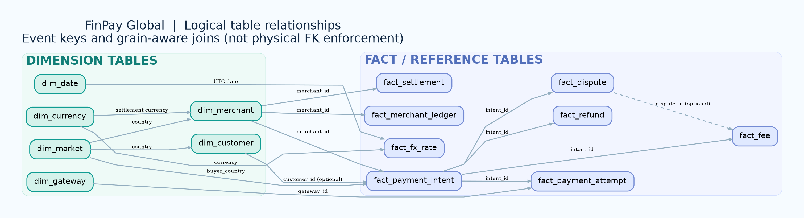

| Child table / column(s) | Parent lookup | Cardinality | Important nuance |
|---|---|---|---|
| `dim_merchant.country_code` | `dim_market.country_code` | N:1 | Market country |
| `dim_customer.country_code` | `dim_market.country_code` | N:1 | Registration country |
| `dim_merchant.settlement_currency` | `dim_currency.currency_code` | N:1 | Accounting currency |
| `fact_payment_intent.merchant_id` | `dim_merchant.merchant_id` | N:1 | Required |
| `fact_payment_intent.customer_id` | `dim_customer.customer_id` | N:0..1 | Guest customer key may be null |
| `fact_payment_intent.buyer_country` | `dim_market.country_code` | N:1 logical | Distinct from merchant country |
| `fact_payment_attempt.intent_id` | `fact_payment_intent.intent_id` | N:1 | Multiple retries |
| `fact_payment_attempt.gateway_id` | `dim_gateway.gateway_id` | N:1 | Gateway per attempt |
| `fact_fee.intent_id` | `fact_payment_intent.intent_id` | N:1 | Multiple fee types per capture |
| `fact_fee.dispute_id` | `fact_dispute.dispute_id` | N:0..1 | Only for linked dispute fee |
| `fact_refund.intent_id` | `fact_payment_intent.intent_id` | N:1 | Multiple refund requests possible |
| `fact_dispute.intent_id` | `fact_payment_intent.intent_id` | 0..1:1 | At most one dispute per intent in contract |
| `fact_settlement.merchant_id` | `dim_merchant.merchant_id` | N:1 | Payout instruction |
| `fact_merchant_ledger.merchant_id` | `dim_merchant.merchant_id` | N:1 | Signed payable postings |
| `fact_fx_rate.currency_code` | `dim_currency.currency_code` | N:1 | FX reference data |
| `fact_fx_rate.rate_date` | `dim_date.date_utc (date portion)` | N:1 logical | Join by UTC date; data types differ |
| `fact_merchant_ledger.source_id` | Depends on ledger event_type | Polymorphic | Do not implement as one FK |

### Ledger source-id interpretation

| `event_type` | `source_id` points to | Sign |
|---|---|---|
| capture_credit | `fact_payment_intent.intent_id` | + |
| merchant_fee_debit | `fact_fee.fee_id` **or source event convention**; inspect generator mapping | − |
| refund_debit | `fact_refund.refund_id` | − |
| dispute_debit | `fact_dispute.dispute_id` | − |
| dispute_fee_debit | `fact_fee.fee_id` **or dispute reference**; confirm exact generator mapping | − |
| payout_debit | `fact_settlement.settlement_id` | − |

**Caution:** The cached ledger example shows a capture posting with `source_id=1` and a related merchant-fee debit also with `source_id=1`; therefore assuming every fee posting’s source is always a `fee_id` would be unsafe. **Verify the exact `source_id` semantics in the synthetic generator before creating polymorphic joins.**

<a id="dimension-tables"></a>
## Dimension tables

Dimension entities describe merchants, customers, geography, gateway configuration, currencies and dates.

### <a id="dim_currency"></a>`dim_currency` — Currency reference

Lookup for the supported transaction and reporting currencies; explains minor-unit scaling.

**Grain:** One currency. **Key:** `currency_code`. **Role:** Dimension.

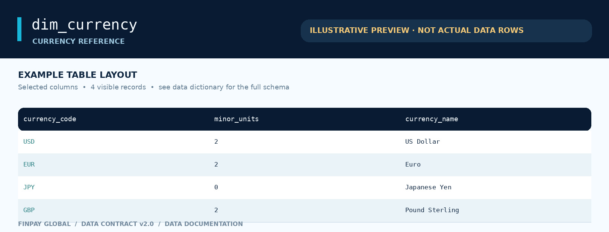


**Column dictionary**

| Column | Prepared type | Definition | Key / derivation / caveat |
|---|---|---|---|
| `currency_code` | string | Three-letter ISO 4217 currency code. | Primary key; referenced by currency columns across dimensions and facts. |
| `minor_units` | integer | Number of decimal places in the currency’s smallest unit. | JPY=0; other ten-currency-contract codes=2 (not a universal rule). |
| `currency_name` | string | Human-readable currency label. | Lookup display attribute. |

**Relationships.** Market `currency_code`; merchant `settlement_currency`; intent `presentment_currency`; fee `settlement_currency`; settlement, ledger and FX `currency_code`.

**Interpretation notes.** The notebook reports 10 unique currencies and explicitly notes JPY has 0 minor units. No source-record preview was attached.

[↑ Back to table of contents](#table-of-contents)

### <a id="dim_market"></a>`dim_market` — Market reference

Countries represented in the fictional operating-market dimension.

**Grain:** One merchant/customer market. **Key:** `country_code`. **Role:** Dimension.

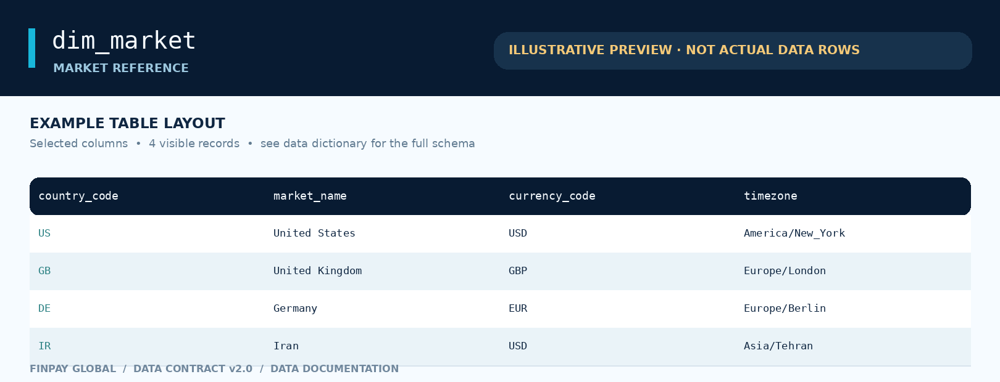


**Column dictionary**

| Column | Prepared type | Definition | Key / derivation / caveat |
|---|---|---|---|
| `country_code` | string | ISO 3166-1 alpha-2 market identifier. | Primary key; merchant/customer country and intent buyer country reference markets. |
| `market_name` | string | Descriptive market/country name. | Display label. |
| `currency_code` | string | Domestic/default market currency. | Foreign key → `dim_currency.currency_code`; IR uses USD under contract. |
| `timezone` | string | Market’s configured time-zone label. | Use for local-time presentation; stored transactional timestamps are UTC. |

**Relationships.** `country_code` is referenced from both merchant and customer dimensions and `buyer_country` in intents. `currency_code` links to the currency dimension.

**Interpretation notes.** Time-zone strings shown in the illustration are examples, not verified source values.

[↑ Back to table of contents](#table-of-contents)

### <a id="dim_gateway"></a>`dim_gateway` — Gateway catalogue

Five gateway endpoints available for routing individual payment attempts.

**Grain:** One fictional processor/gateway. **Key:** `gateway_id`. **Role:** Dimension.

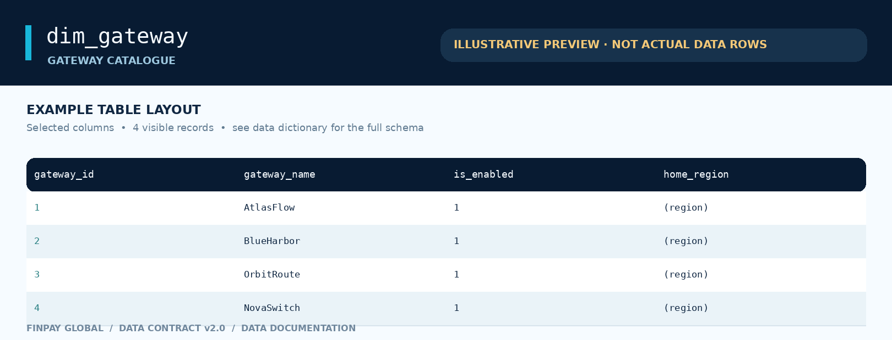


**Column dictionary**

| Column | Prepared type | Definition | Key / derivation / caveat |
|---|---|---|---|
| `gateway_id` | integer | Gateway identifier. | Primary key; foreign key from `fact_payment_attempt.gateway_id`. |
| `gateway_name` | string | Fictional provider name. | Five names specified in project contract. |
| `home_region` | string | Gateway’s representative home region. | Stored text; exact observed values not enumerated. |
| `is_enabled` | integer flag | Whether routing through this gateway is enabled. | 1=enabled; 0=disabled; notebook shows five enabled. |

**Relationships.** One gateway can process multiple attempts; the same intent can use different gateways on retries.

**Interpretation notes.** Gateway name-to-ID assignment and home regions are illustrative: contract verifies five names but not their numerical IDs.

[↑ Back to table of contents](#table-of-contents)

### <a id="dim_merchant"></a>`dim_merchant` — Merchant profiles

Merchant business attributes including operating market, industry, settlement configuration and commercial tier.

**Grain:** One onboarded merchant. **Key:** `merchant_id`. **Role:** Dimension.

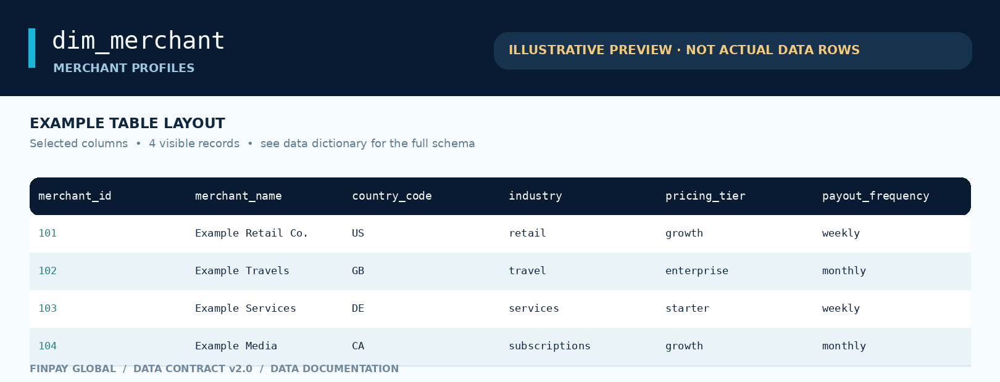


**Column dictionary**

| Column | Prepared type | Definition | Key / derivation / caveat |
|---|---|---|---|
| `merchant_id` | integer | Unique merchant identifier. | Primary key; referenced by intents, settlements and ledger postings. |
| `merchant_name` | string | Fictional business display name. | Not a real legal entity. |
| `country_code` | category | Market in which merchant is registered. | Foreign key → `dim_market.country_code`. |
| `industry` | category | Merchant’s business vertical. | Six observed values; see category dictionary. |
| `onboarded_at` | datetime | Timestamp when merchant joined FinPay. | UTC-by-contract; loaded as timezone-naive Polars datetime. |
| `settlement_currency` | category | Currency used to settle that merchant’s payments. | Foreign key → `dim_currency.currency_code`. |
| `pricing_tier` | category | Commercial fee/pricing package. | `starter`, `growth`, `enterprise`. |
| `payout_frequency` | category | Preferred payout schedule. | `weekly` or `monthly`; actual generator batches monthly. |
| `account_status` | category | Current lifecycle/operational state. | All 2,000 observed active; no other observed statuses. |

**Relationships.** Merchant → payment intents, settlement instructions, merchant ledger (one-to-many). Currency and country are dimension lookups.

**Interpretation notes.** The notebook confirms 2,000 merchants, 12 countries, six industries, 10 settlement currencies, three pricing tiers, two payout frequencies and 100% `active` accounts.

[↑ Back to table of contents](#table-of-contents)

### <a id="dim_customer"></a>`dim_customer` — Registered customer profiles

Registry of 100,000 fictional signed-up buyers. Guest checkouts are represented by a null customer key in payment intents.

**Grain:** One registered customer. **Key:** `customer_id`. **Role:** Dimension.

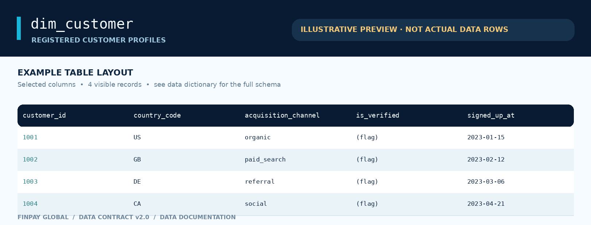


**Column dictionary**

| Column | Prepared type | Definition | Key / derivation / caveat |
|---|---|---|---|
| `customer_id` | integer | Unique registered customer ID. | Primary key; optional foreign key from intents. |
| `signed_up_at` | datetime | Customer registration timestamp. | UTC-by-contract; loaded as timezone-naive datetime. |
| `country_code` | category | Registration market. | Foreign key → `dim_market.country_code`. |
| `acquisition_channel` | category | Channel through which the customer was acquired. | Five observed acquisition channels. |
| `is_verified` | category | Verification indicator associated with customer profile. | Categorical representation; exact raw encodings require data inspection. |

**Relationships.** Customers can have many intents; guest intents have `customer_id=NULL` and must not be treated as orphan errors.

**Interpretation notes.** Five channels and their proportions are confirmed by notebook outputs. Verification flag encodings are not shown.

[↑ Back to table of contents](#table-of-contents)

### <a id="dim_date"></a>`dim_date` — Calendar/date dimension

Reusable calendar fields for daily, weekly, monthly and business-day reporting, derived in Polars.

**Grain:** One calendar date. **Key:** `date_key`. **Role:** Dimension.

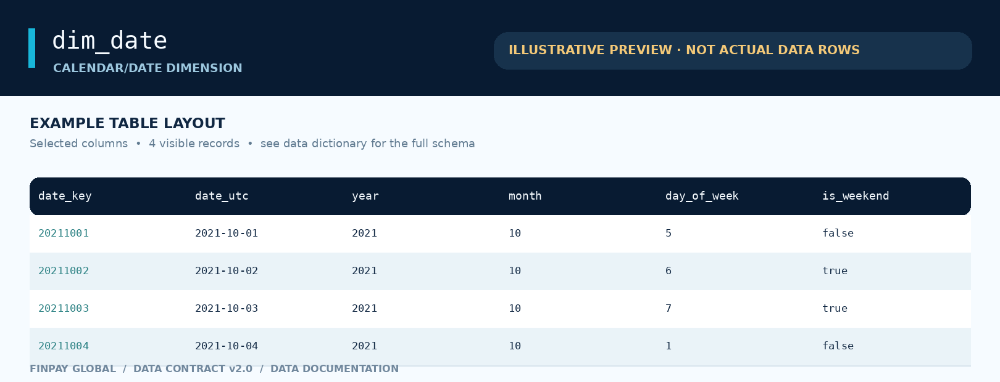


**Column dictionary**

| Column | Prepared type | Definition | Key / derivation / caveat |
|---|---|---|---|
| `date_key` | integer | Numeric key for a calendar date. | Primary key; `fact_fx_rate.rate_date` can match this via calendar date. |
| `date_utc` | datetime | Canonical UTC calendar-date timestamp. | Date identity. |
| `year` | integer | Calendar year. | Derived from `date_utc`. |
| `month` | integer | Month number (1–12). | Derived from `date_utc`. |
| `day_of_month` | integer | Day of month (1–31). | Derived from `date_utc`. |
| `week` | integer | Week of year. | Polars week extraction; check week-year boundaries. |
| `day_of_week` | integer | Day-of-week index. | Polars weekday extraction (Monday=1, Sunday=7). |
| `is_business_day` | boolean | Weekday indicator. | Does not account for local public/bank holidays. |
| `month_start` | datetime | First day of month. | Derived date. |
| `month_end` | datetime | Last day of month. | Derived date. |
| `is_weekend` | boolean | True for Saturday/Sunday. | Cast from raw column. |

**Relationships.** Primarily useful as a reporting date dimension; natural date joins are safer than assuming fact timestamps carry `date_key`.

**Interpretation notes.** Illustrative `date_key` formatting assumes YYYYMMDD; confirm actual encoding before joining.

[↑ Back to table of contents](#table-of-contents)

<a id="fact-tables"></a>
## Fact tables

Facts capture transactional events, accounting movements and the historical FX reference fact.

### <a id="fact_payment_intent"></a>`fact_payment_intent` — Checkout payment intents

Top-level payment requests; includes eventual payment outcome and normalized reporting amounts.

**Grain:** One checkout/payment request. **Key:** `intent_id`. **Role:** Fact.

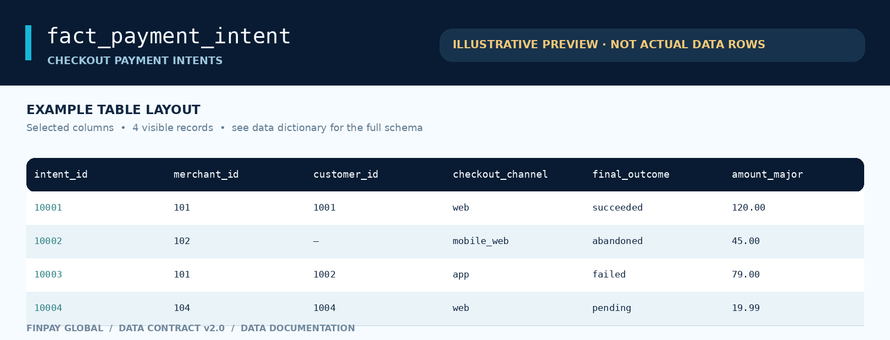


**Column dictionary**

| Column | Prepared type | Definition | Key / derivation / caveat |
|---|---|---|---|
| `intent_id` | integer | Unique checkout/payment request ID. | Primary key; parent of attempts, fees, refunds and disputes. |
| `merchant_id` | integer | Merchant receiving the payment. | Foreign key → `dim_merchant.merchant_id`. |
| `customer_id` | integer, nullable | Registered buyer associated with checkout. | Nullable FK → `dim_customer.customer_id`; null for guests. |
| `created_at` | datetime | Checkout/payment creation time. | UTC-by-contract; primary date for original amount FX normalization. |
| `buyer_country` | category | Buyer’s geographical market. | Logical FK → `dim_market.country_code`. |
| `checkout_channel` | category | Surface where checkout began. | `web`, `mobile_web`, `app`. |
| `presentment_currency` | category | Currency shown/charged at checkout. | Foreign key → `dim_currency.currency_code`. |
| `final_outcome` | category | Intent-level terminal/current state. | `succeeded`, `failed`, `abandoned`, `pending`. |
| `closed_at` | datetime, nullable | Timestamp when intent received a final resolution. | Null for pending. |
| `captured_at` | datetime, nullable | Successful capture timestamp. | Null except for successful captures. |
| `amount_major` | float, derived | Original requested payment amount in major currency units. | Raw `amount_minor` scaled using currency decimals. |
| `captured_settlement_major` | float, nullable, derived | Captured principal in local settlement major units. | Raw `captured_settlement_minor`, null if not captured. |
| `payment_resolution_time` | integer seconds, nullable, derived | `closed_at - created_at`. | Null while pending. |
| `time_to_capture` | integer seconds, nullable, derived | `captured_at - created_at`. | Null when capture has not occurred. |
| `amount_major_usd` | float, derived | Requested amount translated to reporting USD. | `amount_major × usd_per_major_unit` at `created_at` date. |
| `captured_settlement_major_usd` | float, nullable, derived | Captured amount translated to reporting USD. | Same date/currency conversion logic, null without capture. |

**Relationships.** Exactly one merchant; optional customer; 0–3 attempts; multiple fees and potentially refunds; at most one dispute per captured card intent in modeled contract.

**Interpretation notes.** 1,620,000 intents in design contract. Notebook shows guest customer keys (437,109 null), 1,827 pending intents, and 1,435,757 succeeded intents; values are snapshot observations, not current production metrics.

[↑ Back to table of contents](#table-of-contents)

### <a id="fact_payment_attempt"></a>`fact_payment_attempt` — Gateway payment attempts

Operational payment-processing requests. A single intent can retry up to three times after failures.

**Grain:** One gateway authorization/processing attempt. **Key:** `attempt_id`. **Role:** Fact.

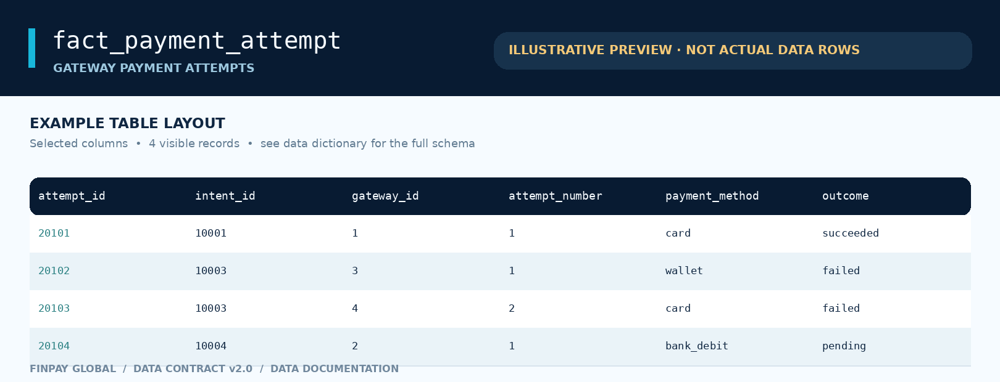


**Column dictionary**

| Column | Prepared type | Definition | Key / derivation / caveat |
|---|---|---|---|
| `attempt_id` | integer | Unique gateway attempt identifier. | Primary key. |
| `intent_id` | integer | Checkout request containing this attempt. | FK → `fact_payment_intent.intent_id`. |
| `gateway_id` | integer | Processor used for this specific request. | FK → `dim_gateway.gateway_id`. |
| `attempt_number` | category | Attempt sequence within the parent intent. | `1`, `2`, `3`; encoded as categorical text. |
| `started_at` | datetime | Time request started. | UTC-by-contract. |
| `finished_at` | datetime, nullable | Time processing completed. | Null if pending. |
| `payment_method` | category | Payment instrument family. | `card`, `wallet`, `bank_debit`. |
| `outcome` | category | Result of a single attempt. | `succeeded`, `failed`, `pending`. |
| `failure_reason` | category, nullable | Diagnostic code for an unsuccessful attempt. | Only populated for failures; five observed categories. |
| `latency_ms` | integer, nullable | Processor attempt latency in milliseconds. | Null for pending. |

**Relationships.** Many attempts per payment intent; each attempt uses exactly one gateway. Attempt success rate differs from checkout conversion.

**Interpretation notes.** The notebook output implies 1,665,396 attempts and 1,568,525 unique attempted intents. It reports 1,827 pending attempts and five detailed failure reasons.

[↑ Back to table of contents](#table-of-contents)

### <a id="fact_fee"></a>`fact_fee` — Merchant fees and processor costs

Monetary charges assessed on successful captures and disputed payment cases; includes both platform revenue and its processing expenses.

**Grain:** One assessed fee/cost event. **Key:** `fee_id`. **Role:** Fact.

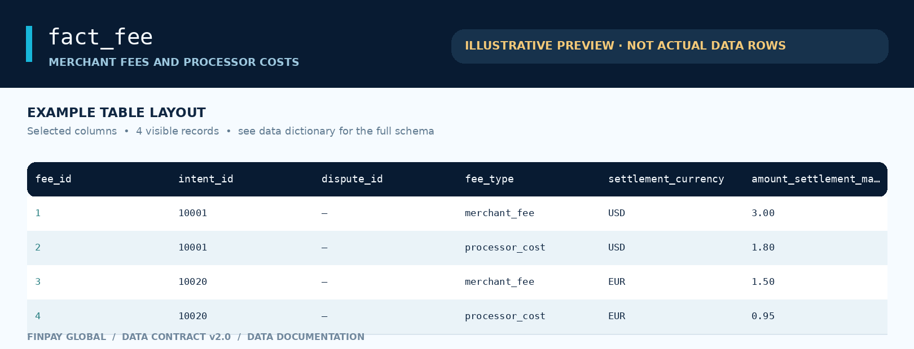


**Column dictionary**

| Column | Prepared type | Definition | Key / derivation / caveat |
|---|---|---|---|
| `fee_id` | integer | Unique fee/cost assessment. | Primary key. |
| `intent_id` | integer | Payment intent to which charge/cost belongs. | FK → `fact_payment_intent.intent_id`. |
| `dispute_id` | integer, nullable | Related lost-dispute record when fee is dispute-specific. | Optional FK → `fact_dispute.dispute_id`. |
| `assessed_at` | datetime | Date/time a fee or cost was assessed. | Used for historical reporting USD FX. |
| `fee_type` | category | Type of assessed financial item. | `merchant_fee`, `processor_cost`, `dispute_fee`. |
| `settlement_currency` | category | Merchant’s settlement currency for the charge/cost. | FK → `dim_currency.currency_code`, derived via merchant. |
| `amount_settlement_major` | float, derived | Assessed amount in local major units. | Original `amount_settlement_minor` scaled by currency decimals. |
| `amount_settlement_major_usd` | float, derived | Assessed amount translated to USD. | Assessment-date FX rate. |

**Relationships.** Intent 1→many fees; optional lost dispute relation. Merchant is reached through intent → merchant, not a direct `merchant_id` field.

**Interpretation notes.** Notebook: 1,435,757 `merchant_fee`, 1,435,757 `processor_cost` and 626 `dispute_fee` events. Processor cost is a platform expense, not a merchant ledger debit.

[↑ Back to table of contents](#table-of-contents)

### <a id="fact_refund"></a>`fact_refund` — Refund requests

Post-capture refunds requested by merchants or customers, with request and resolution times and actual settlement impact.

**Grain:** One refund request. **Key:** `refund_id`. **Role:** Fact.

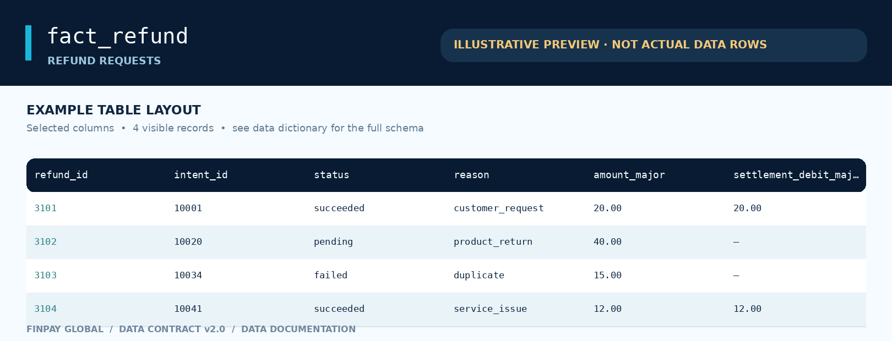


**Column dictionary**

| Column | Prepared type | Definition | Key / derivation / caveat |
|---|---|---|---|
| `refund_id` | integer | Unique refund request ID. | Primary key. |
| `intent_id` | integer | Original payment being refunded. | FK → `fact_payment_intent.intent_id`. |
| `requested_at` | datetime | Refund-request creation timestamp. | Used as fallback FX date when completion FX unavailable. |
| `completed_at` | datetime, nullable | Timestamp of completed refund. | Null if refund is pending. |
| `minutes_to_refund` | float, nullable, derived | Elapsed minutes between request and completion. | Null while incomplete. |
| `status` | category | Refund lifecycle state. | `succeeded`, `pending`, `failed`. |
| `reason` | category | Business reason for the refund. | Four observed reasons; see below. |
| `currency_code` | category, derived | Settlement currency of parent merchant. | Currency FK; obtained by joining through the parent intent. |
| `amount_major` | float, derived | Requested refund amount in major units. | From raw `amount_minor`. |
| `settlement_debit_major` | float, nullable, derived | Amount actually deducted from merchant payable. | Null unless succeeded; from raw `settlement_debit_minor`. |
| `settlement_debit_major_usd` | float, nullable, derived | Successful debit expressed in USD. | Completion-date FX. |
| `amount_major_usd` | float, derived | Requested amount expressed in USD. | Completion-date FX; fallback to request-date FX. |

**Relationships.** Many refunds can belong to one intent, but total successful refunds should not exceed captured principal.

**Interpretation notes.** Saved notebook output: 45,503 refund records; 42,316 succeeded, 1,222 failed, 1,965 pending. Null successful settlement debits are expected for pending/failed cases.

[↑ Back to table of contents](#table-of-contents)

### <a id="fact_dispute"></a>`fact_dispute` — Card dispute cases

Contested captured card payments, their reasons, resolution outcomes and merchant principal debits when lost.

**Grain:** One formal dispute case. **Key:** `dispute_id`. **Role:** Fact.

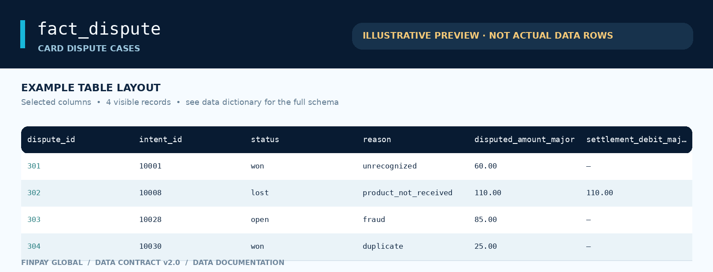


**Column dictionary**

| Column | Prepared type | Definition | Key / derivation / caveat |
|---|---|---|---|
| `dispute_id` | integer | Unique dispute case. | Primary key. |
| `intent_id` | integer | Captured card payment being contested. | Unique FK → `fact_payment_intent.intent_id` in design contract. |
| `opened_at` | datetime | Dispute opening timestamp. | Historical FX fallback date in preprocessing pipeline. |
| `resolved_at` | datetime, nullable | Dispute resolution timestamp. | Null while open. |
| `status` | category | Case result/current status. | `open`, `won`, `lost`. |
| `reason` | category | Chargeback/dispute reason. | Four observed reasons. |
| `disputed_amount_minor` | integer | Principal being contested in merchant settlement minor units. | **Notebook-snapshot field**, not included in the script's selected output. |
| `settlement_debit_minor` | integer, nullable | Principal deducted from merchant payable after a loss. | **Notebook-snapshot field**; null for open/won. |
| `disputed_amount_major` | float, derived | Principal under dispute in major units. | Notebook and script outputs. |
| `settlement_debit_major` | float, nullable, derived | Principal debit after a lost dispute in major units. | Notebook and script outputs. |
| `hours_to_resolve` | number, nullable, derived | Resolution duration in hours. | **Notebook-only** field; current preprocessing instead derives `minutes_to_resolve`. |
| `minutes_to_resolve` | number, nullable, derived | Resolution duration in minutes. | **Script-only** output; see schema drift notes. |
| `currency_code` | category, derived | Merchant settlement currency. | **Script-only** output. |
| `disputed_amount_major_usd` | float, derived | Disputed amount expressed in USD. | **Script-only** output with completion/open-date FX fallback. |
| `settlement_debit_major_usd` | float, nullable, derived | Lost-dispute principal debit in USD. | **Script-only** output. |

**Relationships.** At most one dispute per intent in the intended generator; only lost outcomes reduce merchant payable and incur dispute fees.

**Interpretation notes.** Saved notebook shows 1,834 cases: 1,178 won, 626 lost, 30 open. **The notebook and preprocessing script differ materially in their dispute schema**; the dictionary lists both fields with explicit provenance.

[↑ Back to table of contents](#table-of-contents)

> **Schema drift:** The saved notebook has 11 columns (including `hours_to_resolve`, minor amounts); current `preprocessing.py` instead selects `minutes_to_resolve`, `currency_code` and USD conversion columns, and omits those original minor amounts. Do not treat the union as one concurrently verified table schema.
### <a id="fact_settlement"></a>`fact_settlement` — Merchant payout instructions

Instructions to pay merchant balances. Only completed payouts reduce the merchant payable ledger.

**Grain:** One payout instruction. **Key:** `settlement_id`. **Role:** Fact.

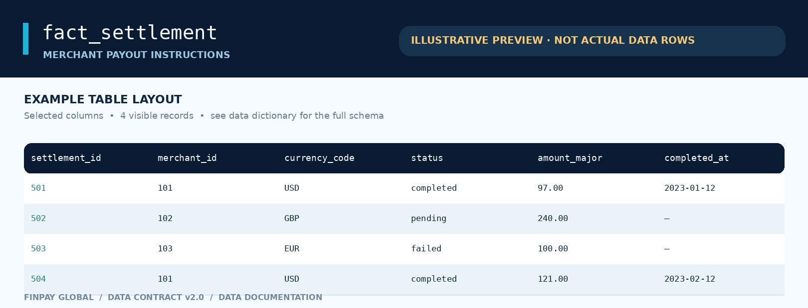


**Column dictionary**

| Column | Prepared type | Definition | Key / derivation / caveat |
|---|---|---|---|
| `settlement_id` | integer | Unique payout/settlement instruction. | Primary key. |
| `merchant_id` | integer | Recipient merchant. | FK → `dim_merchant.merchant_id`. |
| `currency_code` | category | Currency in which merchant is paid. | FK → `dim_currency.currency_code`. |
| `initiated_at` | datetime | Payout instruction created. | UTC-by-contract. |
| `scheduled_at` | datetime | Planned payout timing. | UTC-by-contract. |
| `completed_at` | datetime, nullable | Actual completion timestamp. | Null for pending/failed. |
| `status` | category | Payout lifecycle result. | `completed`, `pending`, `failed`. |
| `amount_minor` | integer | Payout principal in local minor units. | Source field, retained in notebook. |
| `failure_reason` | category, nullable | Diagnostic reason for payout failure. | `bank_return` observed; null otherwise. |
| `amount_major` | float, derived | Payout amount in major units. | Local minor → major conversion. |
| `time_to_scheduled_payout` | integer seconds, derived | `scheduled_at - initiated_at`. | Timing metric. |
| `payout_completion_time` | integer seconds, nullable, derived | `completed_at - initiated_at`. | Missing if incomplete. |
| `schedule_deviation` | integer seconds, derived, invalid | Script currently computes `scheduled_at - scheduled_at`. | Always zero and **not a valid deviation KPI**. |
| `amount_major_usd` | float, derived | Payout normalized to USD. | **Script-only**; FX on completion date, fallback scheduled date. |

**Relationships.** Many payouts per merchant; ledger contains a `payout_debit` only for completed instructions.

**Interpretation notes.** Notebook counts 85,169 payouts from status/failure summaries, including 3,001 bank returns; `amount_major_usd` is in current script but absent from saved notebook schema.

[↑ Back to table of contents](#table-of-contents)

> **Known metric defect:** `schedule_deviation = scheduled_at - scheduled_at` in the current script; do not use it for SLA analysis without correcting and revalidating the pipeline.
### <a id="fact_merchant_ledger"></a>`fact_merchant_ledger` — Merchant payable ledger

Event-sourced subledger of changes to the amount FinPay owes each merchant. Credits positive, merchant payable debits negative.

**Grain:** One signed posting to a merchant-currency balance. **Key:** `entry_id`. **Role:** Fact.

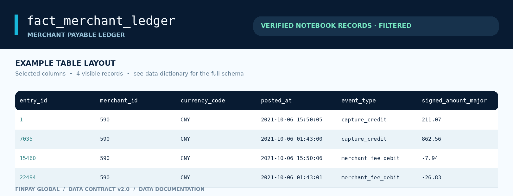


**Column dictionary**

| Column | Prepared type | Definition | Key / derivation / caveat |
|---|---|---|---|
| `entry_id` | integer | Unique ledger posting ID. | Primary key. |
| `merchant_id` | integer | Merchant whose payable changes. | FK → `dim_merchant.merchant_id`. |
| `currency_code` | category | Currency of balance movement. | FK → `dim_currency.currency_code`. |
| `posted_at` | datetime | Posting timestamp. | FX conversion aligned to this date in current script. |
| `event_type` | category | Economic source and effect of the posting. | Six observed event types (full definitions below). |
| `source_id` | integer | ID of event causing this entry. | Polymorphic reference depending on `event_type`; not one universal FK. |
| `signed_amount_minor` | integer | Signed change in merchant payable in **minor** units. | Exact reconciliation should use this field. |
| `signed_amount_major` | float, derived | Signed change in merchant payable in major units. | `signed_amount_minor / 10^minor_units`. |
| `signed_amount_major_usd` | float, derived | Signed reporting USD equivalent. | **Script-only**; posting-date FX. |

**Relationships.** Related to merchant and currency; `source_id` maps to intent/refund/dispute/fee/settlement depending on event type.

**Interpretation notes.** Unlike the other images, these four values are **actual cached notebook output**, filtered to merchant_id=590 and date=2021-10-06; they are **not a claim about the table’s first four rows**. Notebook finds 2,995,584 unique ledger entries.

[↑ Back to table of contents](#table-of-contents)

> **Record fidelity:** The script adds `signed_amount_major_usd`; this field is absent in the notebook’s saved schema. `source_id` is not a safe standalone FK without checking the event-dependent mapping.
### <a id="fact_fx_rate"></a>`fact_fx_rate` — Historical USD foreign-exchange rates

Historical currency conversion lookup for normalizing local amounts to comparable USD financial metrics.

**Grain:** One currency and UTC reporting date. **Key:** `(rate_date, currency_code)`. **Role:** Fact (reference).

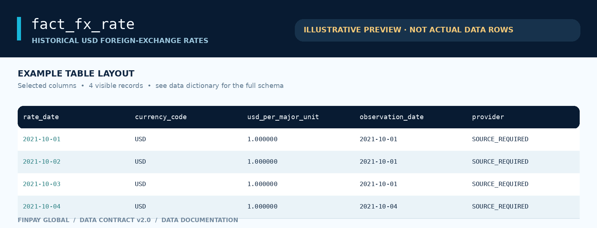


**Column dictionary**

| Column | Prepared type | Definition | Key / derivation / caveat |
|---|---|---|---|
| `rate_date` | datetime | Effective reporting calendar date (UTC). | Composite primary key; join to event date. |
| `currency_code` | category | Currency being converted. | Composite primary key component; FK → `dim_currency.currency_code`. |
| `usd_per_major_unit` | float | USD equivalent of **one major unit** of local currency. | Multiply by local amount; USD self-rate should equal 1. |
| `observation_date` | datetime | Date on which reference rate was genuinely published/observed. | May precede `rate_date` on weekend/holiday. |
| `provider` | category | Rate source attribution. | Must be verifiable; no invented provider labels as actual provenance. |
| `rate_status` | category | Data-state/forward-fill provenance indicator. | Exact encodings not present in attached sources. |

**Relationships.** Logical date link → `dim_date`; direct currency key → `dim_currency`. Join by `(UTC event date, currency_code)` with uniqueness and coverage checks.

**Interpretation notes.** The initial contract states the generated FX table may contain **only USD identity rates**, with real 10-currency coverage requiring a separate import. Notebook USD outputs look populated but their actual FX provenance cannot be verified without source CSVs and manifest. The preview does NOT assert the illustrative observation/provider values are source records.

[↑ Back to table of contents](#table-of-contents)

> **FX gate:** A non-null USD amount in an old notebook does not prove that historical FX rates were genuine, complete, or properly attributed. Publish currency-comparable KPIs only after verifying the complete FX source dataset and manifest.
<a id="categorical-value-dictionary"></a>
## Categorical value dictionary

The following enumerations are drawn from **cached notebook category outputs** where printed, supplemented with **contract-defined** values for currencies, markets, gateway names and allowed lifecycle states. Meanings are business interpretations, not external industry standards. Enumerations that were **not actually shown** in the available sources are separately marked below.

### Markets (`dim_market.country_code`; merchant/customer/buyer countries)

| Value | Meaning |
|---|---|
| `US` | United States |
| `GB` | United Kingdom |
| `DE` | Germany |
| `FR` | France |
| `CA` | Canada |
| `AU` | Australia |
| `JP` | Japan |
| `CN` | China |
| `IR` | Iran — fictional USD-only sandbox |
| `RU` | Russia — fictional market scenario |
| `MX` | Mexico |
| `EG` | Egypt |

### Currencies (`dim_currency.currency_code` and transaction currency fields)

| Value | Meaning |
|---|---|
| `USD` | US dollar |
| `EUR` | Euro |
| `GBP` | Pound sterling |
| `CAD` | Canadian dollar |
| `AUD` | Australian dollar |
| `JPY` | Japanese yen (0 decimals in dataset) |
| `CNY` | Chinese yuan |
| `RUB` | Russian ruble |
| `MXN` | Mexican peso |
| `EGP` | Egyptian pound |

### Merchant industry (`dim_merchant.industry`)

| Value | Meaning |
|---|---|
| `retail` | General consumer retail products |
| `services` | Non-physical services |
| `electronics` | Consumer electronics and devices |
| `food` | Food and dining-related merchants |
| `subscriptions` | Recurring/service subscriptions |
| `travel` | Travel products and bookings |

### Merchant pricing tier (`dim_merchant.pricing_tier`)

| Value | Meaning |
|---|---|
| `starter` | Entry-level merchant pricing package |
| `growth` | Intermediate, scaling merchant pricing package |
| `enterprise` | Large or negotiated merchant pricing package |

### Merchant payout frequency (`dim_merchant.payout_frequency`)

| Value | Meaning |
|---|---|
| `weekly` | Preferred weekly payout cycle |
| `monthly` | Preferred monthly payout cycle |

### Merchant account status (`dim_merchant.account_status`)

| Value | Meaning |
|---|---|
| `active` | Account currently enabled; all 2,000 observed merchants have this status |

### Customer acquisition channel (`dim_customer.acquisition_channel`)

| Value | Meaning |
|---|---|
| `organic` | Unpaid discovery/direct organic acquisition |
| `paid_search` | Sponsored search advertising |
| `referral` | Customer- or partner-referred signup |
| `social` | Social media acquisition |
| `partner` | External distribution/affiliate partnership |

### Checkout channel (`fact_payment_intent.checkout_channel`)

| Value | Meaning |
|---|---|
| `web` | Desktop/browser checkout |
| `mobile_web` | Mobile browser checkout |
| `app` | In-app checkout |

### Intent final outcome (`fact_payment_intent.final_outcome`)

| Value | Meaning |
|---|---|
| `succeeded` | Captured successfully |
| `failed` | Checkout terminated without capture after attempts |
| `abandoned` | Checkout left before any processing attempt |
| `pending` | Still unresolved at snapshot cutoff |

### Attempt sequence (`fact_payment_attempt.attempt_number`)

| Value | Meaning |
|---|---|
| `1` | First processing request |
| `2` | Second request after an earlier failure |
| `3` | Final supported retry after prior failures |

### Attempt method (`fact_payment_attempt.payment_method`)

| Value | Meaning |
|---|---|
| `card` | Card payment |
| `wallet` | Digital wallet payment |
| `bank_debit` | Direct/debit payment sourced from a bank account |

### Attempt outcome (`fact_payment_attempt.outcome`)

| Value | Meaning |
|---|---|
| `succeeded` | The gateway request succeeded |
| `failed` | Gateway attempt failed, with failure_reason |
| `pending` | Request has not completed |

### Attempt failure reason (`fact_payment_attempt.failure_reason`)

| Value | Meaning |
|---|---|
| `insufficient_funds` | Not enough available funds |
| `issuer_decline` | Issuer declined the request |
| `network_timeout` | Gateway/network request timed out |
| `authentication_failed` | Authentication challenge failed |
| `suspected_fraud` | Fraud/risk controls rejected the attempt |

### Fee type (`fact_fee.fee_type`)

| Value | Meaning |
|---|---|
| `merchant_fee` | FinPay fee billed to merchant; platform revenue |
| `processor_cost` | Amount FinPay owes gateway/processor; platform expense, NOT merchant payable debit |
| `dispute_fee` | Fee billed to merchant only when modeled dispute is lost |

### Refund status (`fact_refund.status`)

| Value | Meaning |
|---|---|
| `succeeded` | Refund completed; merchant payable debited |
| `failed` | Refund attempt failed; no merchant balance debit |
| `pending` | Awaiting outcome; no merchant balance debit |

### Refund reason (`fact_refund.reason`)

| Value | Meaning |
|---|---|
| `duplicate` | Duplicated payment or purchase |
| `service_issue` | Problem with purchased service |
| `product_return` | Customer returned purchased product |
| `customer_request` | Customer-initiated refund for other reasons |

### Dispute status (`fact_dispute.status`)

| Value | Meaning |
|---|---|
| `open` | Case remains unresolved |
| `won` | Merchant wins; no lost-principal debit |
| `lost` | Merchant loses; principal and dispute fee debited |

### Dispute reason (`fact_dispute.reason`)

| Value | Meaning |
|---|---|
| `duplicate` | Customer believes transaction was duplicated |
| `product_not_received` | Goods/services not received |
| `unrecognized` | Cardholder does not recognize the charge |
| `fraud` | Charge contested as fraudulent |

### Payout status (`fact_settlement.status`)

| Value | Meaning |
|---|---|
| `completed` | Bank payout completed; merchant ledger debited |
| `failed` | Payout failed; no merchant payable debit |
| `pending` | Payout not completed; no merchant payable debit |

### Payout failure reason (`fact_settlement.failure_reason`)

| Value | Meaning |
|---|---|
| `bank_return` | Receiving bank returned/rejected the payout |

### Merchant ledger event type (`fact_merchant_ledger.event_type`)

| Value | Meaning |
|---|---|
| `capture_credit` | Positive merchant payable credit on successful capture |
| `merchant_fee_debit` | Negative merchant payable for FinPay merchant fee |
| `refund_debit` | Negative payable for successfully refunded amount |
| `dispute_debit` | Negative payable principal for lost dispute |
| `dispute_fee_debit` | Negative payable for lost-dispute merchant fee |
| `payout_debit` | Negative payable for completed merchant payout |

### Other categorical / flag fields requiring verification

| Field | Source limitation |
|---|---|
| `dim_gateway.home_region` | Not enumerated in available notebook/spec; treat as free-text/code pending inspection. |
| `dim_customer.is_verified` | Polars categorical flag; actual encoded values not printed in cached results. |
| `fact_fx_rate.provider` | Provider values and attribution require examination of actual FX file. |
| `fact_fx_rate.rate_status` | Exact encoded status categories unavailable without actual FX data. |
| `dim_market.timezone` | Stored time-zone strings not enumerated from source files; IANA examples in visuals are illustrative. |

**Other binary flags:** `dim_gateway.is_enabled`: 1 enabled, 0 disabled (all five observed 1). `dim_date.is_weekend` and `dim_date.is_business_day` are Boolean. `dim_customer.is_verified` is loaded categorically, so do not presume a specific serialized `true/false` or `0/1` representation without inspection.

**Gateway names — contract, not observed ID mapping:** `AtlasFlow`, `BlueHarbor`, `OrbitRoute`, `NovaSwitch`, `PineBridge` (five fictional providers). The visual’s gateway IDs/names are illustrative because no actual ID mapping was present in the saved outputs.

<a id="currency-time--reconciliation"></a>
## Currency, time & reconciliation

### Currency semantics

| Concept | Rule |
|---|---|
| Local minor unit | Store and reconcile money as **integer minor units** in canonical raw/accounting tables. |
| Major units | `major = minor / 10^dim_currency.minor_units`. JPY has 0 decimals in this dataset; others have 2. |
| Reporting USD | `usd = local_major × fact_fx_rate.usd_per_major_unit` for the currency and specified UTC date. |
| Presentment vs settlement | The data contract assumes **the same merchant currency** is used for presentation and settlement; cross-border FX trades/spread are intentionally not modeled. |
| Rounding / precision | Prepared notebook monetary values are Polars `Float64`; do **not** use floating-point sums for exact ledger sign-off. Preserve integer minor units or DECIMAL in PostgreSQL. |
| FX rate date | Payment intent: `created_at`; fee: `assessed_at`; refund: `completed_at` with request-date fallback; dispute: `resolved_at` with open-date fallback; payout: `completed_at` with scheduled-date fallback; ledger: `posted_at`. |
| FX date completeness | No synthetic or fabricated FX. Carry only truly observed prior business-day rates for weekends/holidays with `observation_date`; reject unexplained gaps. |

### Ledger accounting identity

For each merchant, currency, and as-of date:

```text
closing_merchant_payable_minor
 = captured_gross_minor
 - merchant_fees_minor
 - successful_refunds_minor
 - lost_dispute_principal_minor
 - dispute_fees_minor
 - completed_payouts_minor
 = SUM(fact_merchant_ledger.signed_amount_minor)
```

`processor_cost` appears in the fee fact as FinPay’s **expense**; it is excluded from the merchant payable identity. Unexplained reconciliation residual must equal **zero in integer minor units**. A negative balance after a later dispute can signal a merchant receivable, not necessarily corrupted data.

### UTC, local time and snapshot censoring

The simulation contract uses UTC timestamps with an exclusive event cutoff of **2026-10-01 00:00:00Z**. The Polars loader stores many as timezone-naive datetime values, so the UTC interpretation must be preserved in downstream layers rather than inferred from the Python type. Month/week/day reports should use a consistent **UTC calendar** or explicitly convert for merchant-local analyses. Recent refund/dispute and pending payout cohorts are **right-censored**; compare mature cohorts rather than treating unresolved records as final failures.

<a id="quality-controls--findings"></a>
## Quality controls & findings

### Selected notebook-observed results

| Indicator | Saved result | Interpretation / status |
|---|---:|---|
| Merchant rows | 2,000 | All `account_status=active` in saved counts |
| Currency codes | 10 | JPY only listed 0-decimal currency |
| Country markets | 12 | Iran/USD-only and Russia market assumptions are synthetic |
| Payment intents / succeeded | 1,435,757 succeeded | Of 1,620,000 intended checkouts |
| Payment intents / pending | 1,827 | Null `closed_at` |
| Guest/unknown registered customer ID | 437,109 null intent customer keys | Expected guest checkout |
| Gateway attempts | 1,665,396 | Sum of five gateway counts |
| Attempt outcomes | 1,435,757 succeeded; 227,812 failed; 1,827 pending | Snapshot; distinguish attempt-level and intent-level |
| Fee rows | 2,872,140 | 1,435,757 merchant fee + 1,435,757 processor cost + 626 dispute fee |
| Refunds | 45,503 | 42,316 succeeded, 1,222 failed, 1,965 pending |
| Disputes | 1,834 | 1,178 won, 626 lost, 30 open |
| Merchant payouts | 85,169 | 82,168 without failure reason; 3,001 `bank_return` |
| Ledger postings | 2,995,584 | Cached count of unique entry IDs |
| Null ledger fields | 0 | All 8 cached ledger columns show zero null |
| Schedule deviation | 0 | Not a valid metric: source expression subtracts field from itself |

### Observed categorical distributions (selected)

These percentages are taken from the **saved notebook output**, not fresh executions. Values are examples of existing portfolio analysis, not industry benchmarks.

| Table / variable | Category shares in saved outputs |
|---|---|
| `dim_merchant.industry` | retail **31.85%** · services **18.10%** · electronics **15.90%** · food **14.20%** · subscriptions **12.20%** · travel **7.75%** |
| `dim_customer.acquisition_channel` | organic **35.976%** · paid_search **22.885%** · referral **18.152%** · social **15.021%** · partner **7.966%** |
| `fact_payment_intent.final_outcome` | succeeded **88.627%** · failed **8.083%** · abandoned **3.177%** · pending **0.113%** |
| `fact_payment_attempt.payment_method` | wallet **51.699%** · card **30.281%** · bank_debit **18.020%** (share of **attempts**, not amount/value) |
| `fact_payment_attempt.outcome` | succeeded **86.211%** · failed **13.679%** · pending **0.110%** (attempt-level) |
| `fact_refund.status` | succeeded **92.996%** · pending **4.318%** · failed **2.686%** |
| `fact_dispute.status` | won **64.231%** · lost **34.133%** · open **1.636%** |
| `fact_settlement.status` | completed **94.520%** · failed **3.524%** · pending **1.956%** |

**Interpretation:** the synthetic mix changes depending on the fact grain. A 51.7% wallet share of attempts must not be interpreted as 51.7% of processed dollar volume. The month/currency denominators can differ, and open disputes require mature cohort treatment.

### Validation checklist before release

- [ ] **Primary keys:** unique, non-null at every grain; `(rate_date,currency_code)` unique for FX.
- [ ] **Referential integrity:** every required merchant/intent/gateway/currency/market key resolves; only documented optional keys are nullable.
- [ ] **Lifecycle constraints:** abandoned intents no attempts; retries follow failures; exactly one success for a succeeded intent; no postings for pending/failed payouts.
- [ ] **Money and FX:** valid major-unit conversion, rate coverage for all local dates/currencies, historical provenance, successful settlement amounts and negative/positive ledger signs.
- [ ] **Reconciliation:** zero residual by merchant, currency and cutoff using signed minor-unit entries; fee and source-event accounting counts reconcile.
- [ ] **Temporal:** timestamps ordered, no event after cutoff, and reliable date granularity/timezone convention.
- [ ] **Null semantics:** missing timestamps/amounts tied to business state, not automatically classified as defects.
- [ ] **Drift checks:** compare cached notebook schema vs live preprocessing output and production PostgreSQL table definitions.
- [ ] **Privacy and release:** confirm no accidental real identifiers; establish dataset license, owner, and release manifest.

### Known caveats and drift

| Issue | Evidence | Practical action |
|---|---|---|
| Dispute schema mismatch | Notebook contains `hours_to_resolve` and minor-unit columns; script creates `minutes_to_resolve`, USD and currency fields. | Re-run notebooks against frozen processed version; publish versioned schema. |
| Settlement USD mismatch | `amount_major_usd` is in `preprocessing.py`, absent in saved notebook schema. | Verify notebook kernel and parquet regeneration. |
| Ledger USD mismatch | `signed_amount_major_usd` appears in code but not cached notebook schema. | Recompute materialization and audit FX rate joins. |
| Schedule deviation bug | Script computes `scheduled_at - scheduled_at`. | Fix definition (e.g., actual completion minus scheduled, when applicable) before using SLA dashboards. |
| FX provenance ambiguity | Contract says initial FX export only USD identity; old notebook shows populated USD measures. | Inspect `data/manifest.json` and rate-provider coverage; do not assert rates are genuine from the notebook alone. |
| Ledger source polymorphism | Cached fee-debit sample shares `source_id` with capture-credit sample. | Inspect event-to-source mapping; avoid a one-size-fits-all FK join. |
| Saved notebook error | Refund code cell calling a grouped missing-settlement check has a saved error output. | Re-execute and validate; do not assume all notebook outputs are successful. |
| Currency conversion precision | Processed amount fields stored in Float64. | Keep raw integer minor-unit values for finance accounting. |
| Business-day semantics | `is_business_day` reflects weekdays in Polars. | Do not equate it with actual country/bank holiday schedules. |
| Data previews | Raw first rows were not provided. | Run included preview refresher after you add actual CSV/Parquet files. |

<a id="use-cases--misuse-warnings"></a>
## Use cases & misuse warnings

**Recommended analyses:** checkout intent conversion funnels, retry recovery, gateway/method failure and latency, merchant mix and revenue concentration, customer acquisition, refund and dispute resolution rates by mature cohort, payout SLA completion, merchant payable reconciliation, five-year trends and seasonality, and USD contribution margin *after FX verification*.

**Do not use:** as direct evidence of actual acceptance/fraud losses, country-specific banking access, production pricing, live network availability, merchant risk underwriting, legal eligibility, causal performance attribution, or exchange rates without a verified FX source. Synthetic traffic patterns and intentionally injected disruptions can overstate the apparent predictive quality of a model.

**BI aggregation practice:** derive facts’ financial KPIs from their canonical grain; calculate conversion using distinct `intent_id`, gateway success using `attempt_id`, and ledger balances using `signed_amount_minor` at merchant/currency/date. Avoid computing success rates by blindly dividing attempts by intents; those are distinct units.

<a id="reproduction-governance--changes"></a>
## Reproduction, governance & changes

### Suggested repository layout

```text
project/
├── docs/
│   └── data_card.md                 # This file
│   └── assets/                      # All referenced PNGs
├── src/
│   ├── preprocessing.py
│   ├── visualization.py
│   └── ...
├── data/
│   ├── raw/                         # Original CSVs (not in this bundle)
│   ├── processed/                   # Transformed Parquet (not in this bundle)
│   └── manifest.json                # Publish count/version/FX status here
└── ...
```

The ZIP’s `data_card.md` and `assets/` are ready to copy together into `docs/`. A standalone `scripts/refresh_previews.py` is supplied to turn table preview illustrations into source-backed first-record PNGs when you have the files; its output captions explicitly mark verified source samples. The script is optional and does not modify any raw table.

**Versioning policy (recommended):** include contract version, generation seed, code commit, UTC snapshot cutoff, row counts, raw hashes, processed schemas, FX provider/version and code/data lineage in each release’s manifest. Mark known discrepancies as open issues until the artifacts are re-run against a frozen version.

**Owner/maintenance:** the project contract identifies *Data & BI Engineering* as document owner; a real named steward, contact, update cadence, retention policy and license have not been supplied. **Distribution status:** not independently determined; confirm terms before sharing raw files.

